<div align="center">


# Gall file manager

**Gall is a fast, keyboard-first file manager: instant search over the whole computer, a compare tool for
text, spreadsheets and images, and Vim keys.**
Open source (MIT) · Linux, Windows and macOS · Built with Rust, Tauri and React.

[](https://github.com/GaMa87/gall/actions/workflows/ci.yml)
[](https://github.com/GaMa87/gall/releases)
[](LICENSE)
[-informational)](#install)
[](https://revolut.me/gama87)

**[Download](#install)** · [Website](https://gama87.github.io/gall/) · [Features](#highlights) · [Shortcuts](#usage) · [Git workspace](#git-workspace) · [Build from source](#build-from-source) · [Roadmap](#roadmap)

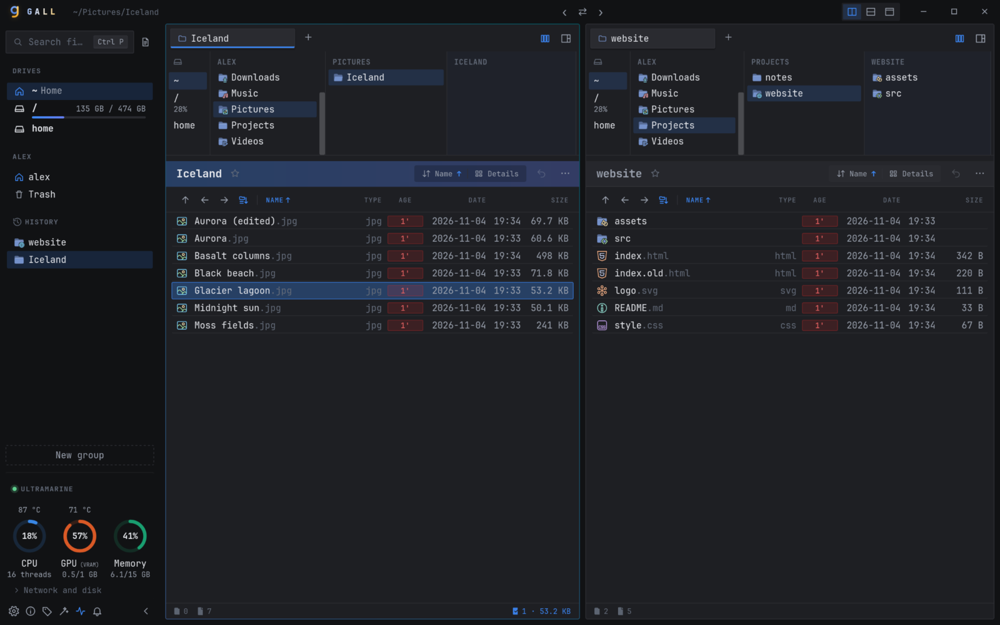

</div>

Gall is a file manager for people who live on the keyboard. It pairs macOS-Finder-style
**Miller columns** with an orthodox **dual-pane** layout (like Total Commander or Midnight Commander),
and it adds instant search across the whole computer, a built-in compare tool and Vim keys.

**Why try it?**

- **Find any file in milliseconds:** fuzzy search over every file name on the computer, as you type.
- **Find a word, variable or macro in every file:** ripgrep-powered search inside files, in the current folder, your home or the whole drive (`/` or `C:\`), with results streaming in and a preview of each match.
- **Compare anything without another app:** code and text, Excel/ODS/CSV cell by cell, photos and images (swipe, onion skin, pixel diff) and whole folders.
- **Git built in:** status letters next to every file, the branch with ahead/behind, and a [Git workspace](#git-workspace) with a history graph, staging of single lines, commits, branches, stashes, interactive rebase and a three-way conflict editor, with lazygit-style keys when Vim keys are on.
- **Archives are folders:** open zip, 7z and tar archives like folders, preview and copy what is inside, extract or compress from the context menu (or Vim `z` keys).
- **Previews that help:** source code with syntax highlighting, Markdown, PDF, images, video, audio and archives, right next to the file list.
- **Undo for every file operation:** copy, move, rename, batch rename and delete to trash are undone with `Ctrl+Z`.
- **Keyboard all the way:** Windows Explorer, Total Commander and Vim profiles, a discoverable command menu, every chord shortcut rebindable. The mouse works too, with drag & drop that says what it will do before you let go.
- **Machine monitor in the sidebar:** CPU, GPU and memory with temperatures, network and disk throughput, free space on every drive.
- **Light on your machine:** a native Rust core in a small Tauri app (no bundled Chromium), with a portable Windows build that runs from a USB stick.

> [!NOTE]
> **New on GitHub, not a new project.** Gall was developed and tested locally for a long time
> before this repository went public. It has been the maintainer's everyday file manager on Linux
> (KDE Plasma, Wayland) and on Windows, and both systems were tested just as thoroughly.
> The history here starts with one initial commit because the private development history was squashed for the public release.
> The [changelog](CHANGELOG.md) shows what went in, and the code ships with over 200 Rust unit
> tests, 100+ UI tests and an end-to-end UI self-test.

It is an independent, clean-room project whose workflows are inspired by the publicly
documented behaviour of OneCommander. It contains no code, assets or text from that
product and is not affiliated with it (see [clean-room policy](docs/00-clean-room-policy.md)).

## Highlights

### ⚡ Find any file on your computer as you type

`Ctrl+P` (Vim: `Space Space`) searches file names in the open folder and below; `Tab` widens it to
every file name on the machine. Gall builds the index
in the background with a parallel walk, so a query over a few hundred thousand paths returns
in tens of milliseconds. Matching is fuzzy and uses fzf-style syntax (`ext:jpg`, `'exact`, `!not`),
and the selected file shows a live preview. Type `>` to switch to the command palette.

Build output stays out of the results: `node_modules`, `target`, `dist`, `build`, folders tagged as
caches (`CACHEDIR.TAG`) and everything `.gitignore` leaves out are skipped. For anything else in a
project, right-click it and choose **Hide from search**, or list it in a `.gallignore` file (gitignore
syntax) in the project folder. A `.gallignore` works without git too, Quick Open, find in files and
`F3` all honour it, and hidden items are dimmed in the file list. When you do need the build output,
`Alt+I` searches ignored files too.

<p align="center">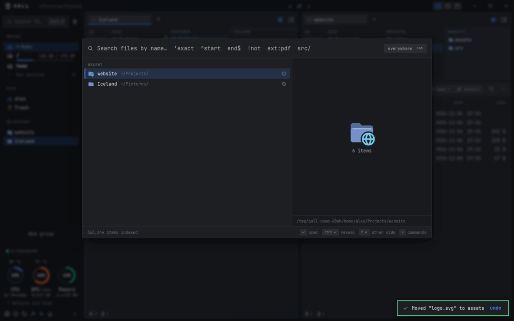</p>

### 🔎 Find text inside files

You know a word is written somewhere, but not in which file. `Ctrl+F` searches the contents of
the current folder and `Ctrl+Shift+F` searches the whole system. The engine is ripgrep's, so it
skips binaries and respects `.gitignore`. Results stream in grouped by file, with a context preview
of each match. Case (`Alt+C`), whole-word (`Alt+W`), regex (`Alt+R`), ignored files (`Alt+I`) and
include/exclude filters are available. `Tab` switches the scope between the folder, your home and
the whole drive (`Shift+Tab` goes back). `↑`/`↓` (or `F4`/`Shift+F4`) step through the matches,
`Enter` opens the file, `Ctrl+Enter` selects it in its folder and `Shift+Enter` does that in the
other browser.

<p align="center">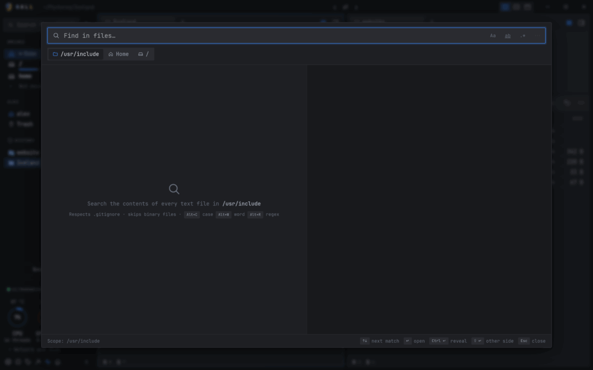</p>

### ↔️ Compare anything: text, spreadsheets, images, folders

Select two files and press `Ctrl+Shift+D` (or `= =` in Vim mode), or drop one file onto another.

- **Text and code:** side by side or unified, word-level highlights, syntax colouring, moved
  blocks detected. Edit, merge changes across and save.
- **Excel, ODS and CSV:** cell by cell. Rows are matched by a detected key column, and
  added or removed rows and columns are listed.
- **Images:** side by side, swipe, onion skin, or a pixel difference with the share of pixels changed.
- **Folders:** compare two folders and sync them. Select many files to get a similarity matrix
  that finds the odd one out. You can also compare a file with the clipboard, a Git revision or any
  file you pick (**Compare with › Choose file…**).
- **Binary files:** a hex compare that jumps between changed bytes.

In every compare view `n`/`N` (or `]`/`[`, `F8`) move between changes and `Esc` or `q` closes. In text,
`u` switches split/unified, `Alt+→`/`Alt+←` copy a change across, `Ctrl+S` saves and `s` swaps the
sides; in folders, `>`/`<` copy the selection and `c` compares contents. `?` lists all of them.

For Git comparisons, select a file and choose **Compare with › Git commit** from its context
menu, or type `= g` in Vim mode. Select a commit with the mouse or arrow keys (Vim `j`/`k`
also work) and press Enter. The graph initially loads 200 commits; **Load 200 more** extends the history, and **Reflog** includes commits without a branch. `= h` compares directly with `HEAD`. The file is looked up by its current path:
if it did not exist at that path in the selected commit, the comparison reports an error.
Opening the comparison does not switch branches or modify files; the working side can still
be edited and saved in the comparison view. Type `+ +` in Vim mode
to focus the other browser; `=` and `+` show their available next keys.

<table>
<tr>
<td>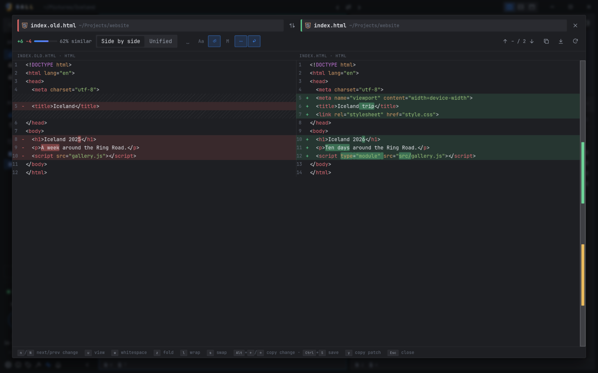</td>
<td>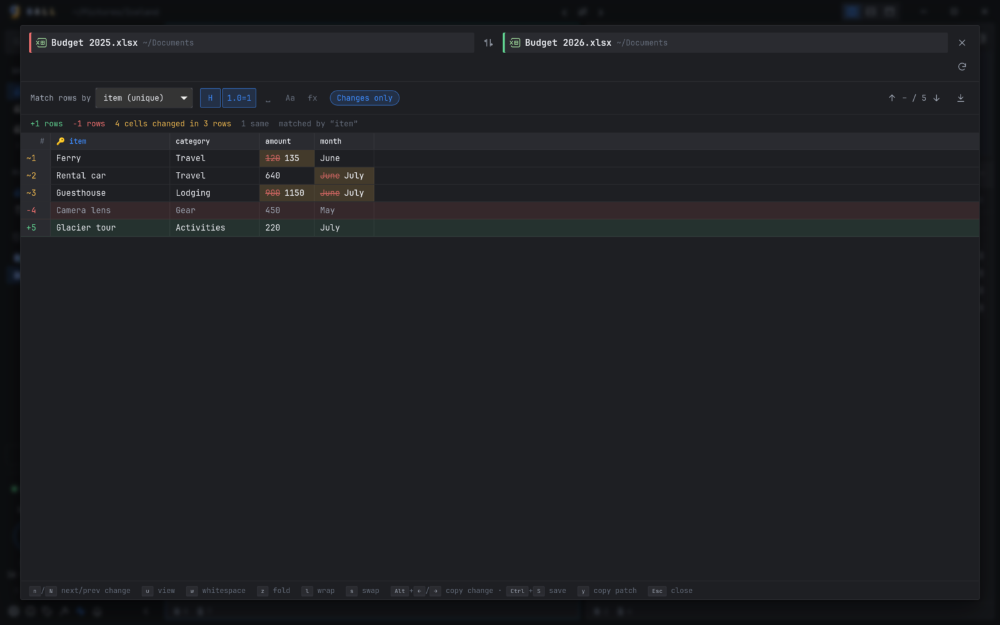</td>
</tr>
<tr><td align="center">Text, with word-level changes</td><td align="center">Two Excel files, cell by cell</td></tr>
<tr>
<td colspan="2" align="center">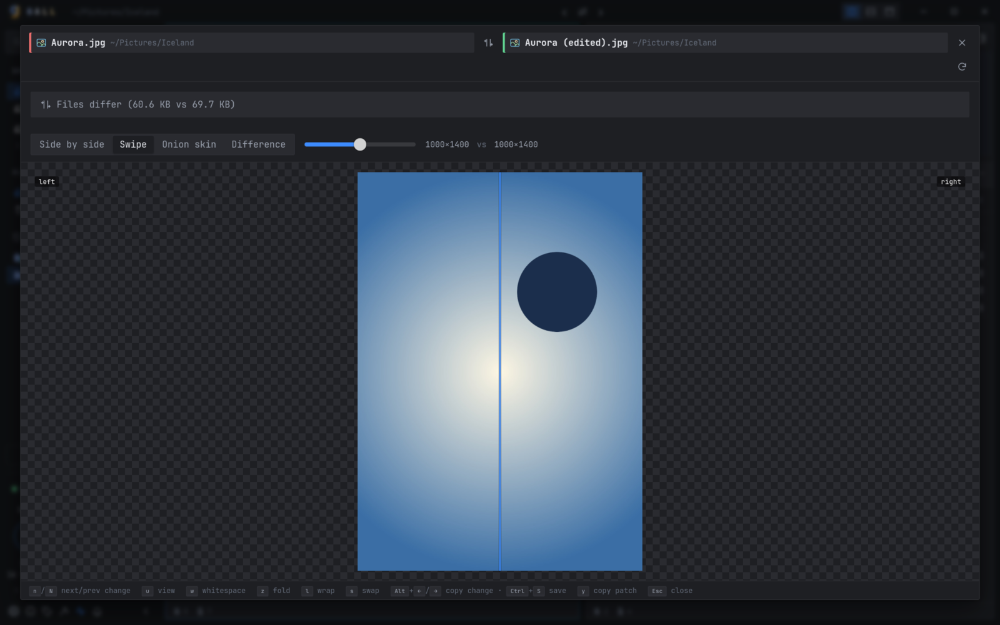<br>Images: drag the divider to swipe between versions</td>
</tr>
</table>

### 🌿 A Git workspace inside the file manager

Click the Git status at the bottom, type `g r` with Vim keys or choose **Open Git graph** in the
command palette to open the repository of the current folder. Browse the history graph, inspect any commit, file history and blame, stage single
lines or hunks and commit, manage branches, tags, stashes and remotes, fetch, pull and push with
progress, and rewrite history with reword, fixup, squash, drop or an interactive rebase. Conflicts
open in a three-way editor. Everything is in menus and buttons; with Vim keys on, keys follow lazygit,
the footer shows the ones that fit the focused panel and `?` lists that panel's keys (without Vim
keys, the **?** button in the header does). Browsing never checks anything out or changes files.
See [Git workspace](#git-workspace) for the full guide.

### ⌨️ Familiar keys, and a menu shows you the rest

Choose **Windows Explorer**, **Total Commander** or **Vim** in welcome setup or
**Settings › Keyboard**. [The profile table](#keyboard-profiles) lists their function keys.
Every profile keeps Gall's search, comparison, archives, pins, tabs and other commands.

With Vim selected, `j` `k` move, `h` `l` go up and into folders, `gg` `G` jump, `yy` `dd` `p` copy, cut and paste,
`/` filters. Press `Space` and a which-key menu lists every command, grouped LazyVim-style
(`Space s g` greps, `Space d d` compares, `Space t n` opens a tab). Press `?` for a searchable
sheet of every shortcut. Prefer plain shortcuts? Choose Explorer or Commander: the same `?` opens
the searchable keyboard reference, including standard navigation and selection keys.
`Shift+F1` and `Ctrl+/` work in every profile too; `?` still types normally in text fields.
Tap `Ctrl` twice for the command menu. Pin or unpin the current folder with `Ctrl+B`,
or with Vim keys on, `b` or `Space b p`.
`Space v` toggles the focused item's selection without moving; `Space o m` opens its
context menu. Plain `v` still starts visual selection.

Folder marks work as in Vim: `m a` remembers the current folder under the letter `a`
(`a`–`z` and `A`–`Z` are separate marks), `' a` goes back to it from anywhere, and
`` ` a `` also selects the item that was focused when you marked it. `''` returns to the folder
you jumped from, and `d m a` deletes the mark. After `m`, `'` or `` ` `` the which-key popup lists
your marks with their folders. Marks are kept between sessions. With Vim keys the colour tag is `c` and columns ⇄ breadcrumbs is
`Space w c`.

<table>
<tr>
<td>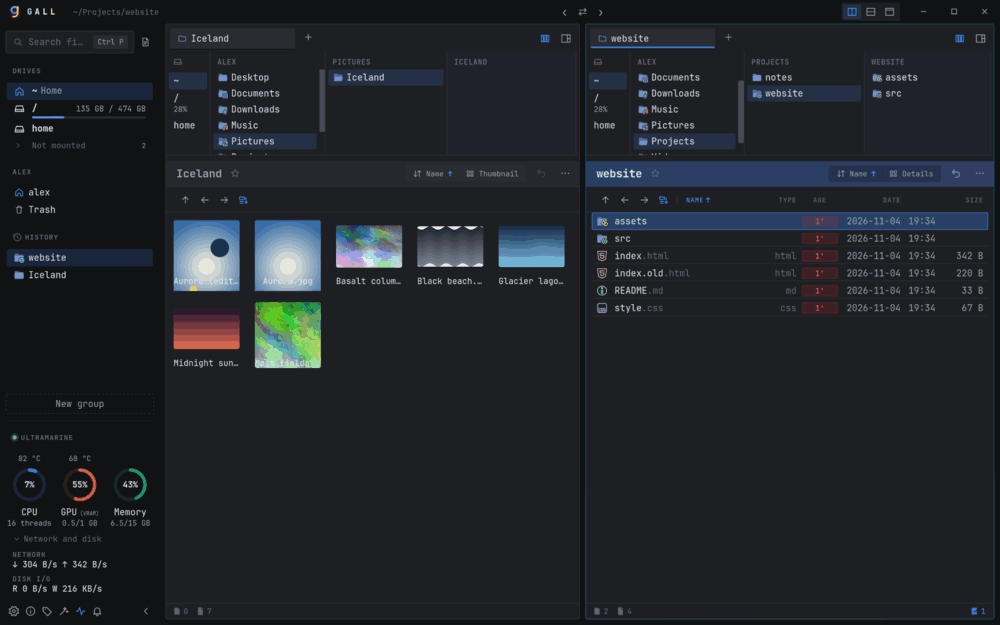</td>
<td>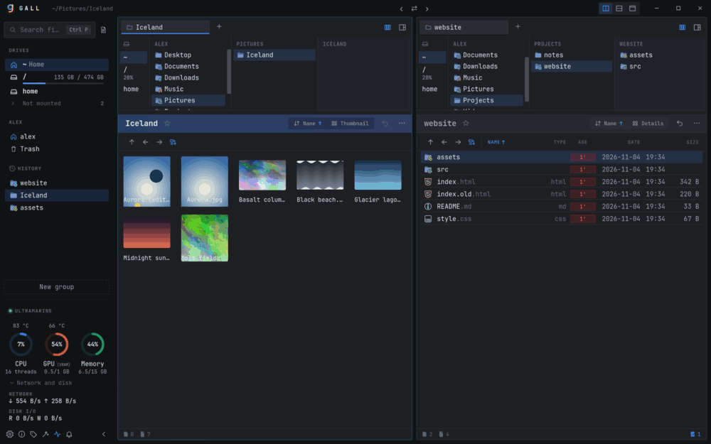</td>
</tr>
<tr><td align="center"><code>j</code> <code>k</code> <code>l</code> <code>h</code> through folders</td><td align="center"><code>Space</code> opens the command menu</td></tr>
<tr>
<td colspan="2" align="center">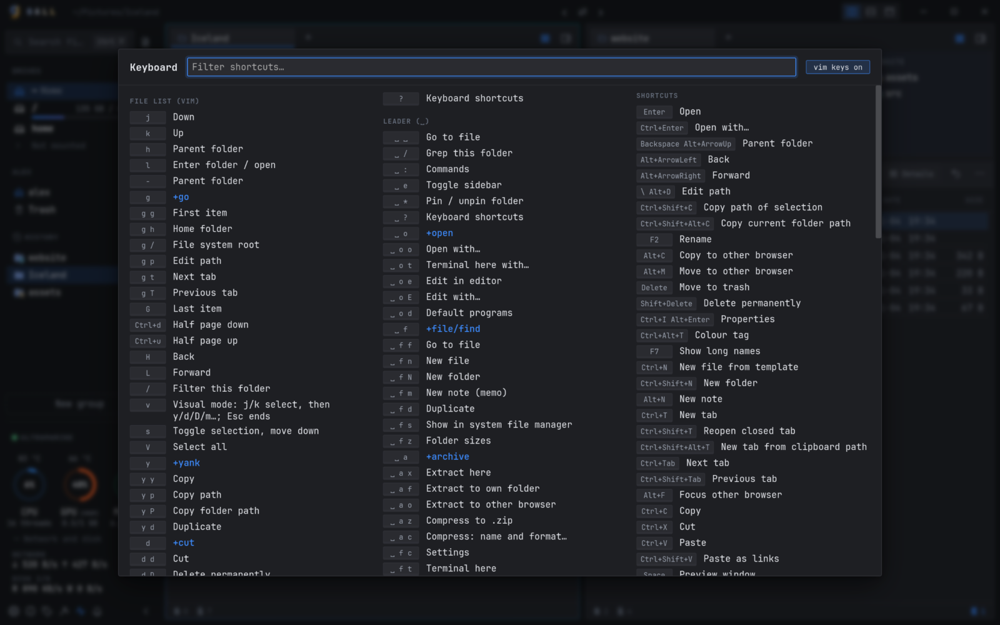<br><code>?</code> lists every shortcut, and you can rebind any chord shortcut</td>
</tr>
</table>

### 🤓 A look made for the terminal crowd

Monospace type, a dark theme by default, and file icons from Nerd Fonts and Catppuccin.
If no Nerd Font is installed, Gall falls back to SVG icons. Colour-coded file age, folder colours,
a light theme and an accent colour are built in, and [themes](docs/themes/README.md) restyle the rest: Catppuccin and Gruvbox are included.

### 📊 A small system monitor in the sidebar

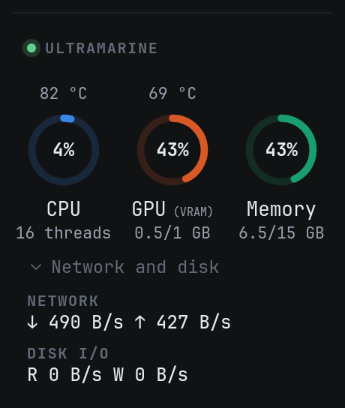

CPU, GPU and memory at a glance, with temperatures. Expand it for network and disk throughput.
Every drive in the sidebar shows a usage bar and free space. Hide the monitor with one click if you don't want it.

<br clear="right">

### 🖥 Linux, Windows and macOS

One codebase in Rust and Tauri, packaged for every major desktop: AppImage, `.deb` and `.rpm`
for Linux, an installer or a **portable** zip for Windows, and a `.dmg` for macOS. The core
is unit-tested on all three systems in CI.

## Everything else

| | |
|---|---|
| 🏛 **Miller columns** | Every folder of the path is a column. Ancestor columns compress; hovering expands one. Toggle with breadcrumbs using `` ` `` (Vim: `Space w c`). |
| 🪟 **Dual pane + 3 layouts** | Side by side, Stacked (current folder as last column) and Single, from the layout buttons in the title bar or `Ctrl+Shift+L`. Above the divider, ‹ and › hide one browser, ⇄ swaps their folders (`Ctrl+U`) and a right-click toggles each browser's details pane. Drag a divider past the edge to collapse a pane, double-click it to centre it. A window narrower than 760 px shows one browser. |
| 🗂 **Tabs** | Per pane. Clone, reopen closed (`Ctrl+Shift+T`), new tab from a path on the clipboard (`Ctrl+Shift+Alt+T`), aliases, drag to reorder or to the other pane, drop a tab on **+** to duplicate it, drop files on a tab to move them there, close others or stale tabs, mouse wheel switches tabs. Restored on start. |
| 📄 **File list** | Natural sort remembered per folder, folders on top, colour-coded age, type-to-filter (`.pdf` filters by extension; accents are ignored, so `porocilo` finds `Poročilo`; typing in a Miller column filters that column), rubber-band selection (also middle-drag), 5 views inherited by subfolders (`Ctrl+wheel` sizes grid thumbnails), a folder background image (`cover.jpg`, `folder.jpg`…). The folder header has an undo button for the last operation in that folder, a pin star and a **⋯** menu (folder colour, compare with the other browser's folder). |
| 👁 **Previews** | Images (zoom to cursor, pan), PDF, video/audio (frame-step), STL 3D models (drag to rotate, wheel to zoom), text/code with syntax colours, rendered Markdown, archives, notes. `Alt+P` shows the preview & details pane in the focused browser; `Space` (Vim: `i`) opens a large preview window. There, `+`/`-`/`0`/`1` zoom images and PDFs, `[`/`]` step video frames and `k` plays or pauses. |
| 📦 **Archives** | `Enter` opens zip, 7z and tar (gz, xz, bz2, zst) archives as read-only folders: preview, copy or open single entries. Encrypted zip and 7z ask for the password (kept in memory only). The context menu extracts here, to a folder per archive or to the other browser, and compresses to zip, tar.gz or 7z; hold `Ctrl` in the menu to also move the extracted archive to the trash (undoable). |
| 📏 **Folder sizes** | `Ctrl+Alt+S` counts the selected folders, or all folders in the current view if no folders are selected, and shows their totals in the Size column. Enable **Calculate automatically** in the **Folder sizes** menu to count folders in the background. Running totals while it counts; it stays on one drive and counts hard links once. Sorting by size uses completed totals. On Linux, kernel virtual filesystems such as `/proc` and `/sys` are not scanned and show `—` because their folder size is not applicable. |
| 🌿 **Git status** | Letters next to names in a repository (`M` modified, `S` staged, `U` new, `!` conflict; folders show what is inside), ignored files dimmed, and the branch with ↑ ahead / ↓ behind in the status bar. Safe in downloaded repositories: none of their configured commands run. |
| ✏️ **Rename** | `F2` (Commander: `Shift+F6`) renames; pressing it again in the field selects the name, the extension or everything. On several items it opens batch rename: a name template (`Trip {n:2}`, `{date}`, `{folder}`), find & replace with regular expressions, case changes, or edit all names as text. A live preview flags clashes; one `Ctrl+Z` undoes it all. |
| ↩️ **Undo everything** | Copy, move, rename, batch rename, create, extract, delete-to-trash: `Ctrl+Z` (until Gall is closed). Background task queue with progress, time left, cancel and conflict handling. When a folder already exists, **Merge** combines both (keep both, replace, replace older or skip for files in both), and one `Ctrl+Z` reverts the whole merge. |
| 🚀 **Open with, terminal, editor** | `Ctrl+Enter` lists programs for a file; `Ctrl+Enter` in that list always uses the program for the type, and `Tab` narrows that rule to the project, the folder or only this file. `F10` opens a terminal here (`Ctrl+F10` chooses one), `Ctrl+Alt+E` (Commander and Vim: `F4`) edits in your editor (`Shift+F4` chooses one). |
| 🖱 **Honest drag & drop** | A label shows *"Move 3 items to Photos"* or *"Copy …"*. Hold `Ctrl` = copy, `Shift` = move, `Alt` = symlink. The default (move / copy / by drive / ask) is configurable. |
| 🏷 **Tags, notes, templates** | Colour tags (`Ctrl+Alt+T`, Vim `c`; the name search's **Tags** tab lists tagged items), folder colours (right-click › **Folder colour**), `.2do` notes with a done checkbox (`Alt+N`), new files from your own templates (`Ctrl+N`; right-click › **Create file template** adds one). |
| 📁 **New folder, paste, duplicate** | In the new-folder dialog, `Ctrl+Enter` creates and opens the folder and `Shift+Enter` moves the selection into it. `Ctrl+D` duplicates, `Ctrl+Shift+V` pastes as symbolic links, `Ctrl+I` shows properties (with the folder's total size). Hold `Ctrl` while a context menu is open for alternatives such as **Edit with…**, **Terminal here with…** or extract-and-trash. |
| ☁️ **Sidebar** | Drives with usage bars, **Eject** and **Lock**; **Not mounted** volumes mount with a click, and encrypted ones ask for the passphrase. Cloud folders (OneDrive, Dropbox, Google Drive, iCloud, Box, MEGA, pCloud, Nextcloud, Proton and others), favourites groups (**New group** at the bottom, **+** adds the current folder, drop a folder on a group title, drag to reorder, aliases), history, and the **Trash** window (restore, show the original folder, delete for good, empty; drop files on Trash to trash them). Middle-click any item for a background tab; with two browsers, hover a favourite to open it on the left or right. |
| 🔔 **Notifications** | Messages wait while the pointer is over them, and the bell button (or `Shift+~`) opens the log of earlier ones. `q` closes Quick Open, compare views, the preview and other windows in every profile. |
| 🎨 **Make it yours** | Searchable settings, every chord shortcut rebindable, dark/light/system theme, accent colour, custom CSS themes. |
| 🔄 **Updates** | Gall checks for a new stable release at startup and in **Settings › Updates**, and installs signed updates where the package supports it. Portable and system-managed installations show how to upgrade by hand. |
| 🐞 **Bug reports** | **Report a bug** in About prepares a report with screenshots, annotations and short clips of Gall, then fills in the GitHub form; nothing is uploaded automatically ([details](#report-a-problem)). |

<table>
<tr>
<td>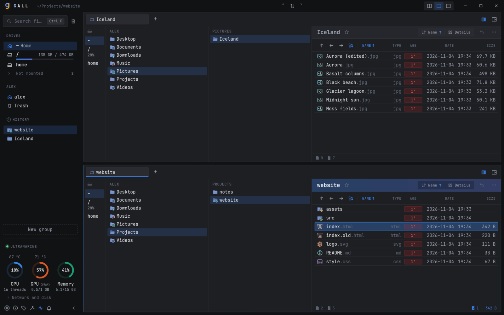</td>
<td>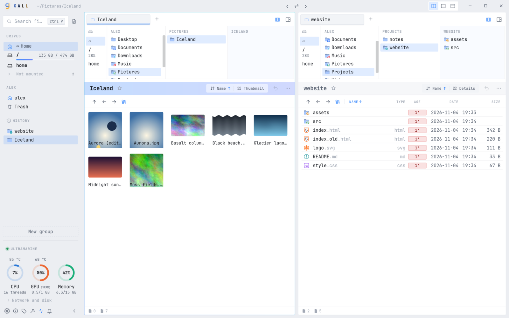</td>
</tr>
<tr><td align="center">Columns layout</td><td align="center">Light theme, thumbnail grid</td></tr>
<tr>
<td colspan="2" align="center">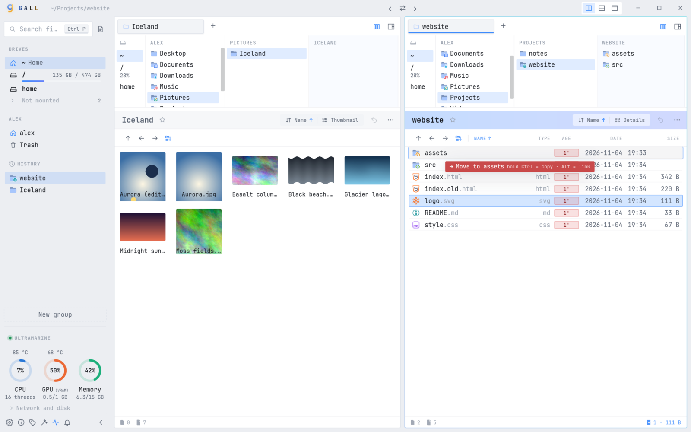<br>Drag & drop always says what it will do</td>
</tr>
</table>

Full feature status: [docs/04-compatibility-matrix.md](docs/04-compatibility-matrix.md).

## Install

Download a package for your system from **[Releases](https://github.com/GaMa87/gall/releases)**.
Linux and Windows are equally well tested; macOS builds are experimental.

| System | Package | Install |
|---|---|---|
| Any Linux | `Gall_<version>_amd64.AppImage` | `chmod +x Gall_*.AppImage && ./Gall_*.AppImage` |
| Fedora (with updates) | [COPR](https://copr.fedorainfracloud.org/coprs/gama87/gall/) | `sudo dnf copr enable gama87/gall && sudo dnf install gall` |
| Fedora, openSUSE | `Gall-<version>-1.x86_64.rpm` | `sudo dnf install ./Gall-*.rpm` |
| Debian, Ubuntu, Mint | `Gall_<version>_amd64.deb` | `sudo apt install ./Gall_*.deb` |
| Windows 10/11 | `Gall_<version>_x64-setup.exe` or `.msi` | run the installer |
| Windows, no install | `Gall-<version>-windows-x64-portable.zip` | unzip and run `gall.exe` |
| macOS (Apple silicon / Intel) | `Gall_<version>_aarch64.dmg` / `_x64.dmg` | open and drag to Applications |

The macOS build is not signed or notarised yet: if macOS refuses to open it, allow it in
*System Settings › Privacy & Security › Open Anyway*.
Flathub, AUR, Scoop, winget and Homebrew packages are in preparation; see [packaging](packaging/README.md)
if you would like to help.

**Portable (Windows):** `Gall-<version>-windows-x64-portable.zip` needs no installation. Unzip it
anywhere (a USB drive works) and run `gall.exe`; everything stays in `UserData` next to it.
Build it yourself with `./scripts/portable.ps1` on Windows or `./scripts/portable.sh` on Linux
(cross-compiled with [cargo-xwin](https://github.com/rust-cross/cargo-xwin)); the output is in `dist/`.

On Linux, the `.deb` and `.rpm` packages register Gall as a file manager, so you can choose it
as the default (for example in Plasma's *Default Applications › File manager*, which also makes
`Meta+E` open Gall).

Video preview on Linux plays through the webview's system GStreamer codecs (Fedora: `gstreamer1-plugins-good`,
`gstreamer1-libav`; Debian/Ubuntu: `gstreamer1.0-plugins-good`, `gstreamer1.0-libav`).

## Build from source

Requirements: Rust ≥ 1.95, Node ≥ 20, and the [Tauri v2 prerequisites](https://v2.tauri.app/start/prerequisites/)
(Fedora: `webkit2gtk4.1-devel libsoup3-devel gtk3-devel openssl-devel librsvg2-devel`;
Debian/Ubuntu: `libwebkit2gtk-4.1-dev libsoup-3.0-dev libgtk-3-dev librsvg2-dev`).

```sh
git clone https://github.com/GaMa87/gall.git && cd gall
npm install && npm install --prefix ui
npm run dev          # run with hot reload
npm run build        # release build + installers in target/release/bundle/
npm test             # Rust + UI unit tests
npm run lint         # fmt, clippy, typecheck
./scripts/selftest.sh   # end-to-end UI test of a debug build (KDE; opens a window for ~1 min)
```

## Usage

```
gall [PATH]             open PATH in the left pane
gall -p2 PATH           open PATH in the right pane
gall PATH --newtab      open PATH in a new tab
```

Gall runs as a single instance: starting it again sends the paths to the open window and brings it to the front.

Some shortcuts: `Ctrl+P` find a file · `Ctrl+F` / `Ctrl+Shift+F` find text · `Ctrl+Shift+D` compare ·
`?` all shortcuts · `Shift+F6` rename · `Alt+C`/`Alt+M` copy/move to the other pane · `Ctrl+Shift+N` new folder ·
`Alt+F7` name search · `F10` terminal here · `Alt+P` preview pane · `Alt+S` sidebar ·
`Ctrl+,` settings. Vim letters take precedence over a few Ctrl chords; `?` shows the keys
that actually work. Chord shortcuts are editable in *Settings › Shortcuts*.

### Keyboard profiles

Select a profile in **Settings › Keyboard**, or during welcome setup:

| Key | Windows Explorer | Total Commander | Vim |
|-----|------------------|-----------------|-----|
| `F1` | Keyboard help | Keyboard help | Command palette |
| `F2` | Rename | Refresh | Rename |
| `F3` | Name search | Preview | Name search |
| `F4` | Edit address | Edit file | Edit file |
| `F5` | Refresh | Copy to other pane | Refresh |
| `F6` | Other pane | Move to other pane | Move to other pane |
| `F7` | Show long names | New folder | Show long names |
| `F8` | Move to trash | Move to trash | Move to trash |

These profiles adapt familiar workflows to Gall, rather than emulate every command
of another application. Gall additions remain available in all profiles:
`Ctrl+R` refresh, `Ctrl+Alt+E` edit file, `Ctrl+Alt+L` long names,
`Shift+F4` choose editor, `F10` terminal, `Ctrl+B` pin (Vim: `b`),
and `Ctrl+Shift+P` the full command palette. `Ctrl+Insert` also copies and
`Shift+Insert` pastes. `Ctrl+F3`/`F4`/`F5`/`F6` sort by name/type/modification date/size
(ascending); the leader's `,` group offers every sort direction.

Explorer and Commander let you type to filter; `Tab` switches panes, `Space` previews,
and `Insert` marks an item and advances. Tap `Ctrl` twice for the grouped Gall command
menu. Vim keeps its normal motions, `yy`/`dd`/`p`, `/` to filter and `Space` as leader.
`?`, `Shift+F1` and `Ctrl+/` show profile-aware help in all three.

The selected profile is saved. Older settings with Vim enabled select Vim; with it
disabled they select Windows Explorer. Existing custom shortcuts and leaders are
preserved. **Custom chord overrides apply to all profiles and win over profile
defaults.** Clearing a shortcut field in Settings restores the current profile's default.

The keyboard reference uses individual keycaps and a three-part legend: **`+` means hold
together**, **`→` means press in order, releasing between steps**, and **`or` means choose
one shortcut**. For example, `Ctrl + C` is simultaneous; `g → g` is two presses.
Uppercase Vim commands are explicit (`Shift + g`, not an unexplained `G`), and the basic
leader appears as `Ctrl → Ctrl`, not a held combination. Search-query examples are
shown as literal text rather than keyboard shortcuts.

Middle-click a tab to close it (the last tab stays open); `Ctrl+Shift+T` reopens it.
`Alt+Middle-click` still moves a tab to the other pane.

### New in 0.1.3: search scope and exclusions

Open a folder and press `Ctrl+P`: Quick Open now searches **that folder and its subfolders**
first. Press `Tab` to switch to **everywhere**, and again to return. In WSL, on a network
share or outside the indexed folders, Gall reads the open folder on demand; you can type
while it says "Reading…". "Everywhere" searches the system index, not every unindexed
share or WSL distribution. Configure permanent roots in *Settings › Search › Indexed folders*.
Inside an archive, Quick Open searches the system index; folder scope and `Alt+I` are unavailable.

To keep generated or noisy items out of results, right-click them and choose **Hide from search**.
This writes a `.gallignore` next to the items; it does not delete them or change `.gitignore`.
They remain visible in the file list, dimmed and italic. Right-click **Show in search again**
to remove the rule or add an exception; a hidden folder's header also lets you show it again.
Hide from search offers Undo.

You can edit `.gallignore` yourself. For example, put this in your project folder:

```gitignore
# Skip generated output and logs
/generated/
*.log
# Keep this log searchable
!important.log
```

Rules use gitignore syntax and apply to that folder and everything below it, even outside
a Git repository and when a search starts in a subfolder. Quick Open, find in files and
the name search (`F3`) all respect them. Edits are picked up without manually rebuilding
the index. Global exclusions live in *Settings › Search › Never index or search*;
folders with a valid `CACHEDIR.TAG` are skipped too.

**Need an ignored item just this time?** In find in files or `F3`, `Alt+I` toggles inclusion
of ignored files, including `.gallignore`, `.gitignore`, excluded folders and caches.
In Quick Open, `Alt+I` instead opens the name search in the current folder with ignored
files included; it does not add them to the index. That search uses plain names and
wildcards (`*`, `?`), rather than Quick Open's fuzzy syntax. `Ctrl+H` only changes the
file list's hidden-file visibility; it does not remove search exclusions.

### Windows: browse WSL distributions

Installed WSL distributions appear in the sidebar's **Drives** group. Expand **Not mounted**
and click a stopped distribution to start and open it; running ones appear among the drives.
You can also type `\\wsl.localhost\Ubuntu\home\yourname` in the path bar (replace the names
with your own); Gall also supports `\\wsl$\Ubuntu\…` on older Windows installations.
Typing `/etc` opens it in the current WSL distribution, or the default one when outside WSL.
Docker Desktop's internal distributions are intentionally hidden; this is not Docker container browsing.

Browse, preview, rename, copy and move as usual, including between Windows and WSL or between
distributions. **Terminal here** (`F10`) opens a shell in that distribution's current folder.
In find in files, **Home** refers to the Linux home when opened from WSL. Use
**Copy path › Linux path (WSL)** for `/home/…` or `/mnt/c/…`; the default format is configurable
in Settings.

Delete inside WSL normally uses the distribution's Linux trash; `Ctrl+Z` restores the items.
Gall's Trash window shows only the Windows Recycle Bin, so use undo or a Linux file manager
for WSL trash. If trash is unavailable, Gall asks before deleting permanently; that cannot
be undone. Copying names Windows cannot store into Windows is refused with an explanation.
For an individual name ending in a dot or space, rename it in a WSL terminal first;
copying a normally named folder within WSL can preserve such names inside it.

The eject button **Stop … (WSL)** terminates the whole distribution, not just Gall's view.
Save work in its other programs before confirming. If external changes do not appear,
press `Ctrl+R` to refresh in any keyboard profile.

More details and a manual verification checklist: [WSL support](docs/wsl-manual-test.md).
The [0.1.3 changelog](CHANGELOG.md#013--2026-11-05) lists the accompanying fixes.

### Settings, data and themes

On Linux, settings are in `~/.config/gall/` and data in `~/.local/share/gall/`; **Settings › About**
shows the exact folders on every system. A file named
`portable` next to the executable switches storage to `./UserData` (settings, data, logs and the
webview's cache).

**Themes:** Catppuccin and Gruvbox are included; pick them in *Settings › Appearance › Custom theme*.
For other themes, put `mytheme.css` into `~/.config/gall/themes/` and pick it from the same menu;
`Ctrl+Shift+F5` reloads it while you edit. [docs/themes](docs/themes/README.md) has a guide and a
Dracula example.

## Git workspace

The Git workspace opens the repository of the current folder in a full-window view: the history
graph with Working Changes as its first row, a sidebar with branches, tags, stashes, remotes and
conflicts, and the details of the selected commit. Everything is available from menus and buttons;
with Vim keys, lazygit-style keys and the footer hints make it a keyboard tool. The sections below
explain each part.

### Git graph and revision switching

Click the bottom Git status, or type `g r` in Vim mode, to open the Git workspace.
The status shows the commit subject and current branch. For detached HEAD it lists
local branches containing that commit, or `detached` if none do; the tooltip still
identifies detached HEAD explicitly. A containing branch does not attach HEAD to it.

The graph starts with 200 commits. **Load 200 more** extends it up to 20,000 commits;
search matches the loaded commit hashes, messages, authors and reference names.
The reference selector narrows history to a branch or tag. **Reflog**, available
with **All references**, includes otherwise unreachable commits and is off by default.
Selecting commits, searching, filtering and opening diffs do not change HEAD or files.

Select a commit to inspect its full message, author, committer, dates, parents and
changed files below the graph. Select a file for its colored patch, historical
contents, rename-aware history or line blame. For merge commits, choose the parent
to compare against. Parent buttons and blamed lines navigate to their commits.
Shift-click a second commit to compare the two revisions;
alternatively mark a comparison base with `W`, select another commit and press `W` again.
The ordinary file comparison menu and `= g` use the same graph as a read-only
revision picker for the selected working file.

Right-click a commit or reference (or focus it and press `Shift+F10` or the Menu key, or
click its **⋯** button) for the actions of that item, grouped into submenus: Rewrite
history, Integrate and more. **Actions** in the toolbar holds the repository-wide ones:
fetch, pull, push, force push with lease, stash, refresh, search and a terminal. In Vim
mode `?` lists the keys of the focused panel, which follow lazygit, and the footer always
shows the most useful ones. Move between panels with `h` and `l` (sidebar, commit list,
details; Working Changes is the first commit row, so `l` there opens it), switch sidebar
tabs with `[` and `]`, and press `Esc` to close details and return to the commit list.
Without Vim keys, `Tab` and `Shift+Tab` move between panels. On a commit, `l` or `Enter`
opens its details, `y` opens a menu of things to copy (hash, subject, message, author,
date, URL, whole diff, tags), and `b`, `w` and `x` open the repository tools on bisect,
worktrees and the default tab; `Esc` or `h` returns to the commit list. The panel with keyboard focus
has an accent outline and is named in the footer, and the other panels show their selection muted. Plain rebase and
merge on a commit are menu-only; on a branch they are `r` and `M`. The current branch is listed first and marked, with
its ahead/behind counts. During a merge or rebase conflict the panel names the commit
being applied; choose Ours, Theirs or Both (click a side to pick it) and watch the live
Result, or press **Edit** to change it by hand before confirming. Esc or `q` asks
before leaving the workspace. If a push is rejected, use **Actions → Force
push with explicit lease…** after checking the remote commits.

**Checkout…** is an explicit action. Select a commit or a local branch, then choose
Checkout; selecting a branch alone does not switch files. With local changes,
choose **Stash**, **Commit**, or **Discard**. Stash includes untracked files and is
not automatically reapplied. The preparation commit stages all tracked and
untracked changes. Discard requires a second confirmation and retains a recovery
stash named `Gall recovery before discard`; ignored files are preserved.
Switching does not force overwritten files. Errors leave any created stash or
commit available for inspection.

Explicit checkout replaces working files and can update filesystem modification
times. The file browser reports those real disk timestamps; the graph reports
commit dates. Gall does not change timestamps to make checkout look like an old edit.
Before leaving detached HEAD, Gall retains it under `refs/gall/recovery/`; detached
commits created by Gall are retained there too and labeled **Saved commit**.

### Review and commit selected files

Select the **Working Changes** row connected above HEAD. Staged and unstaged
changes appear separately below the graph. **Stage file** and **Unstage file**
change the index while preserving the working contents; **Stage all** and
**Unstage all** operate on the whole change list. A partially staged file appears
in both groups. Enter a message and choose **Commit staged** to commit only the index.
A new repository can make its first commit here.

For ordinary tracked text files, select changed lines with their checkboxes, or
select a whole hunk with its ± button, then choose **Stage selection** or
**Unstage selection**. Additions, deletions, renames, binary or mode changes, very
large patches and files without a final newline use whole-file staging instead.
A stale HEAD, index or file snapshot cancels the action and asks you to refresh.

**Amend latest commit** pre-fills an empty message with the previous message and
replaces the latest commit using the index; the original commit is retained for
recovery. **File actions…** offers confirmed discard of unstaged changes, with a
recovery stash, and ignore rules for untracked files in `.gitignore` or the local
`.git/info/exclude`. Discard preserves staged changes and unrelated files.

### Branches, stashes, remotes and conflicts

The side panel lists local/remote branches, tags, stashes, remotes and conflicted
files. Select an item and use its context menu (right-click, `Shift+F10` or **⋯**) or
`?` for the commands available there; **+** creates a new item. You can create and rename branches, delete merged local branches,
set upstreams, create lightweight or annotated tags, and delete local tags.
Stashes can be saved, inspected, applied, popped or dropped; conflicting pop keeps
the stash, and dropped stashes retain a recovery reference.

Reference actions include merge, rebase, cherry-pick, revert and soft/mixed/hard
reset. Confirmations name the target. History rewrites retain the previous HEAD;
hard reset also preserves tracked edits and refuses untracked or ignored files.
An in-progress operation stays visible with **Continue**, **Skip** and **Abort**.
The Conflicts panel shows base, current Git side, incoming Git side and working
result. Choose a side for the whole file, edit it manually, or mark the current
result resolved. During rebase, Git's ours/theirs meanings differ from a merge;
the confirmation explains them. A merge cannot be skipped.

Remotes can be added, renamed, removed or given a new fetch URL. **Fetch** updates
remote history; **Pull** only fast-forwards, so diverged work must be merged or
rebased explicitly after fetching. **Push** publishes the current branch and sets
its upstream. Force push requires an explicit, reviewed remote commit lease.
Network progress has a Cancel action; cancellation cannot undo a completed push.
Configured credentials are used without interactive prompts. Complete interactive
login or SSH setup in the terminal before retrying.

### Edit commit history

With history focused, `r` opens a message-only reword dialog for the selected commit.
Rewording HEAD preserves staged changes; rewriting an older commit requires a clean,
linear history through HEAD. Descendant IDs change, and Gall retains the original HEAD.

`f` fixes up the selected commit into its preceding commit, `s` squashes their
messages, and `d` drops the selected commit. Ctrl+j/Ctrl+k or Alt+Down/Alt+Up
move it earlier/later in the linear history after confirmation. These direct actions
use the same recovery and conflict handling as the interactive editor.

`i` opens **Edit commits through HEAD**, including the selected commit and its
following commits. The **Unchanged base (exclusive)** is their parent and stays
unchanged. Select pick, reword, squash, fixup, drop or edit for each row; reorder rows
by dragging, using their arrow buttons, or pressing `J`/`K`, Ctrl+j/Ctrl+k or
Alt+Up/Alt+Down. Reword and squash rows expose their messages. **Start rebase…**
confirms the exact range. An edit action pauses: stage changes in Working Changes,
amend that commit, then Continue. Conflicts and edit stops can be resumed after restart.
The editor accepts at most 1,000 linear commits and does not rewrite the root or
preserve merge topology. Use an external Git client for those cases.

### Git keyboard controls and repository tools

Outside the workspace, `g r` opens it and `= g` compares a file with a commit.
Inside, commands use direct contextual keys inspired by lazygit, without an extra
`g` prefix. `?` shows the focused panel's commands; menus and buttons remain available
with Vim keys disabled. `j`/`k` navigate, and typing in fields always stays ordinary typing.

| Focus | Useful Vim keys |
| --- | --- |
| History | `r` reword, `i` interactive rebase, `f` fixup, `s` squash, `d` drop, Space checkout, `n` branch, `T` tag, `C` copy for cherry-pick, `V` cherry-pick, `t` revert, `g` reset, `W` comparison base, `/` search |
| Working Changes | Space stage/unstage, `a` stage/unstage all, `c` message, `A` amend, `d` discard, `i` ignore/exclude, `s` stash, `l` diff, `h` files |
| Diff selection | Space select a changed line, Enter apply selection, `u` unstage selected changes |
| Commit details | `d` diff, `v` file, `f` history, `b` blame, `y` copy path, `e` edit working file, `h`/`l` focus files/preview |
| References | Space checkout, `n` branch, `R` rename, `d` delete merged branch, `M` merge, `r` rebase, `u` upstream |
| Stashes | Space apply, `g` pop, `d` drop, `s` save |
| Remotes | `n` add, `e` edit URL, `r` rename, `d` remove |

Open **Tools** (or **Repository setup…** after opening `g r` outside a repository)
and choose a tab. **Repository** initializes the current folder or clones into a
new destination. The other tabs provide worktree creation/opening/locking/removal, recorded-submodule
initialization/update, manual bisect, patch export/application and commit notes. Tool tabs have direct Vim keys shown beside
their names and in **Keys ?**. A worktree is created at a full commit ID, optionally
on a new branch; removal requires a clean unlocked worktree. Submodule updates do
not recurse and refuse local changes. Bisect records good/bad/skip results and
**Finish / reset** returns to the starting revision. Patch application checks and
stages a patch in a clean repository; export never overwrites an existing file.
Failed or cancelled clones retain their partial destination for inspection.

Gall creates unsigned commits and disables repository hooks. Content-filter/LFS
repositories and submodule worktrees remain restricted for index changes, checkout
and history operations, even though inspection and dedicated submodule tools are
available. This is not full parity with GitLens, Git Graph, Git Extensions or lazygit.
See the [Git workspace coverage matrix](docs/git-workspace-roadmap.md) for concrete
limits, external workflows and focused validation commands.

## Architecture

```
React + TypeScript UI  ──typed IPC──▶  Tauri shell  ──▶  gall-core (pure Rust)
                                                        fs · nav · view · preview · storage
```

The core has no UI dependency and is unit-tested on Linux, Windows and macOS. Details are in
[docs/03-architecture.md](docs/03-architecture.md).

## Roadmap

- Image conversion
- Multiple and named windows
- Thumbnail cache in Rust
- Drag files *out* to other applications
- Packages for Flathub, AUR, Scoop, winget and Homebrew ([plan and status](packaging/README.md); help welcome)

## Contributing

Contributions are welcome. Read [CONTRIBUTING.md](CONTRIBUTING.md) and the
[clean-room policy](docs/00-clean-room-policy.md). Report bugs with the issue templates and
security problems via [SECURITY.md](SECURITY.md).

### Report a problem

Choose **Report a bug** in **About** or **Settings → About**. A short description is
enough; reproduction steps and expected behavior are optional. Your draft stays in
memory while Gall is open, including when you close the dialog to reproduce a problem.
`Esc` closes the report, or cancels an open save/annotation step; it works with Vim
keys on or off. After a successful GitHub handoff, the next report starts fresh.
The current report stays open so you can still copy or save its attachments.

- **Capture Gall** hides the report and counts down three seconds before capturing
  Gall's own webview, not your desktop or other apps. **Annotate** adds arrows, boxes
  and opaque redactions. Use **Add mark**, then arrow keys to position a mark
  (`Shift` resizes); `h/j/k/l` also work when Vim keys are enabled. **Apply changes**
  permanently flattens redactions into the image; no original is exported alongside it.
- **Record a clip** records Gall for up to 20 seconds, without microphone, camera or
  system audio. Reproduce the problem, then choose **Stop recording**. Play the clip
  back before sharing: screenshot redactions do not apply to recordings. Clips are
  intentionally lightweight (up to 4 frames per second, 1280 × 800), not full-motion
  desktop recordings. Encoding uses MP4 or WebM, depending on the installed webview.
  You can stop from anywhere in Gall with `Ctrl+Shift+Enter` or cancel with
  `Ctrl+Shift+Backspace` (`Cmd` also works on macOS). Capture completion never
  replaces another open dialog or editor; the attachment waits in your report.
- **Add a file** accepts PNG, JPEG, WebP, MP4 and WebM. Up to three attachments,
  8 MiB each. If built-in capture or encoding is unavailable, use your system's
  screenshot/recording tool and add the resulting file instead.
  Built-in capture uses WebView2 on Windows and WebKitGTK on Linux; macOS currently
  requires importing a capture made with the system tools.

The copied report contains your description, basic environment information
(including installation type and Gall's window resolution in physical pixels)
and **only the latest recorded error**, not the action history. **Session** means
the current session or the previous irregular exit. If no error was recorded,
the report says so. Expand **Preview GitHub report** before sharing, and check
captures and error text for private details. Nothing is automatically uploaded.

**Save report...** creates one ZIP containing `report.md` and every retained
screenshot or video. Only the finalized images are included, never the originals
behind applied redactions. Attach the ZIP to your GitHub issue to share everything
together. The suggested name includes a UTC timestamp. After a successful save,
the save form closes and returns to your report; if saving fails, the form stays
open so you can correct the path or retry. Creating the ZIP does not upload it.

**Save report...** enables **Include extra diagnostics** by default.
This adds recent actions, UI context and sanitized log excerpts
to the **saved file only**, never to **Copy report** or **Copy & open GitHub**.
Uncheck the option to save just the compact report and your attachments.
Automatic redaction can miss private details;
review **Preview saved diagnostics** before sharing a saved file.

Choose **Review report**, then **Copy & open GitHub**. The short report and title are
sent in the browser URL and the GitHub form is already filled in. Gall also copies
the report as a backup. The live counter below your description shows the remaining
characters in the encoded GitHub link, including the title and environment.
Accents, emoji and special characters use more space than ordinary letters.
If the link is too long, Gall recommends saving a ZIP and attaching it to the issue
instead; your full description is preserved in the saved report.
For images, return to Gall and choose **Copy screenshot**, then paste below the
report. Copying an image replaces the clipboard text. For videos, use **Save
attachment** and drag the file into GitHub.
GitHub uploads attachments immediately when added; a public issue and its uploaded
attachments can be seen by others. A GitHub account and final browser submission
are required. Finish or cancel any active capture before opening GitHub.
**Save report...** and **Save attachment** create new local files
using an editable absolute path; existing files are never replaced.
After an irregular exit, Gall can offer diagnostics from the previous session.

## Support

Gall is free and built in spare time. If it saves you time, you can buy me a coffee:
**[revolut.me/gama87](https://revolut.me/gama87)** (Revolut, revtag `@gama87`), or scan the code.
Stars, bug reports and pull requests help just as much. Thank you!

<a href="https://revolut.me/gama87"></a>

## License

[MIT](LICENSE) © 2026 Gall contributors.
Third-party components and their licences are listed in [THIRD-PARTY-NOTICES.md](THIRD-PARTY-NOTICES.md).
All are permissive or weak file-level copyleft (MPL-2.0, unmodified). This is enforced in CI with [`cargo-deny`](deny.toml).

<sub>Keywords: file manager, file explorer, Miller columns, column view, dual pane, orthodox file manager, fuzzy file search, find in files, ripgrep, diff, file compare, Excel compare, image diff, vim, which-key, Nerd Font, Tauri, Rust, Linux, Windows, macOS, KDE, GNOME, Wayland.</sub>
