<div align="center">


# Gall

**The keyboard-first file manager for Linux, Windows and macOS.**
Clickable breadcrumbs and orthodox dual panes, millisecond whole-disk search, built-in compare for code, Excel and images, a full Git workspace, and `Ctrl+Z` undo — in a native Rust + Tauri app.

[](https://github.com/GaMa87/gall/actions/workflows/ci.yml)
[](https://github.com/GaMa87/gall/releases)
[](LICENSE)
[](#install)
[](https://revolut.me/gama87)

<br>

**[Download Latest Release](https://github.com/GaMa87/gall/releases/latest)** &nbsp;·&nbsp;
[Website](https://gama87.github.io/gall/) &nbsp;·&nbsp;
[Highlights](#highlights) &nbsp;·&nbsp;
[Install](#install) &nbsp;·&nbsp;
[Usage &amp; Keys](#usage) &nbsp;·&nbsp;
[Git Workspace](#git-workspace) &nbsp;·&nbsp;
[Build](#build-from-source)

<br>

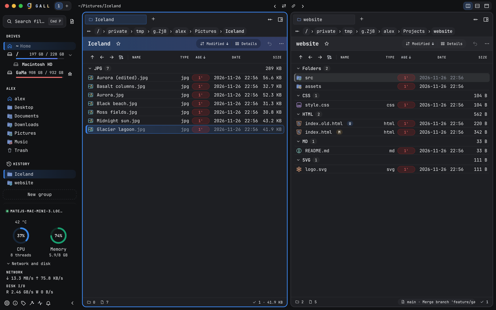

</div>

<br>

| Core pillar | What it replaces in daily work |
| --- | --- |
| **Breadcrumbs + dual pane** | Clickable breadcrumb path bars (click to jump, middle-click for new tab, drop files onto any ancestor) paired with an orthodox two-pane layout, numbered Workspaces (`Alt+1..9`), and linked Tab Pairs. |
| **Millisecond search** | Fuzzy Quick Open (`Ctrl+P`) across hundreds of thousands of paths plus ripgrep content search (`Ctrl+Shift+F`) with live previews. |
| **Built-in compare** | Structural code diff, Excel/ODS/CSV cell diff, image swipe/onion-skin/pixel diff, PDF/DOCX document diff, hex diff, and folder sync. |
| **Git workspace** | Inline file status plus a full-window Git graph, line/hunk staging, interactive rebase, worktrees, blame, reflog, and three-way merge. |
| **Keyboard-first, zero guesswork** | Windows Explorer, Total Commander, and Vim profiles, LazyVim-style `Space` which-key groups, and a searchable `?` shortcut sheet. |
| **Universal undo & native speed** | `Ctrl+Z` reverses copy, move, rename, batch regex rename, folder merge, extract, and trash. Native Rust core + Tauri v2 (no bundled Chromium). |

> [!NOTE]
> **New on GitHub, not a new project.** Gall was developed and used daily on Linux (KDE Plasma, Wayland) and Windows before going public; the private history was squashed into the initial public commit. See the [changelog](CHANGELOG.md) for what shipped — the codebase includes over 200 Rust unit tests, 100+ UI tests, and an end-to-end UI self-test.
>
> Gall is an independent, clean-room project whose workflows are inspired by the publicly documented behaviour of OneCommander. It contains no code, assets, or text from that product and is not affiliated with it ([clean-room policy](docs/00-clean-room-policy.md)).

---

## Highlights

### Instant search across your computer

Press <kbd>Ctrl+P</kbd> (Vim: <kbd>Space</kbd> <kbd>Space</kbd>) to fuzzy-search file names in the current folder; press <kbd>Tab</kbd> to widen to every indexed path on the machine. Matching supports fzf-style filters (`ext:jpg`, `'exact`, `!not`), live previews, and command palette mode via `>`. Build artifacts (`node_modules`, `target`, `dist`, `CACHEDIR.TAG`, `.gitignore`, and project `.gallignore`) stay out of results unless you toggle <kbd>Alt+I</kbd>.

For text inside files, <kbd>Ctrl+F</kbd> searches the current folder and <kbd>Ctrl+Shift+F</kbd> searches the drive using ripgrep — streaming grouped results with match previews, regex (`Alt+R`), whole-word (`Alt+W`), and case (`Alt+C`) toggles.

<div align="center">
  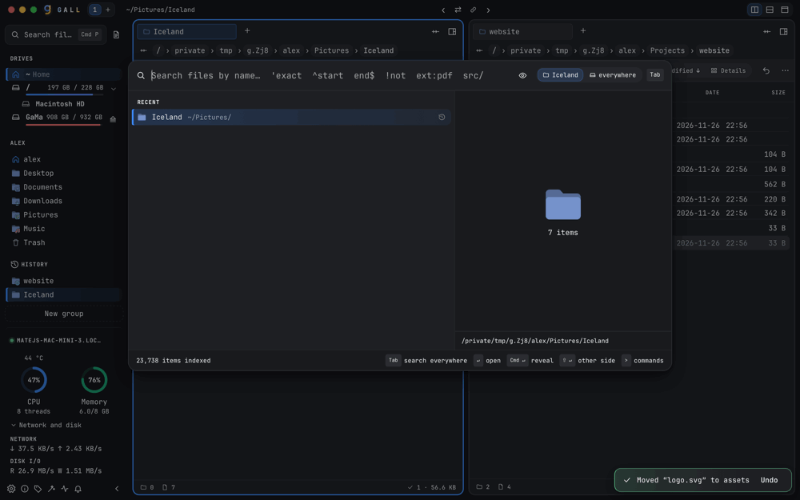
  <br><sub><b>Quick Open (<code>Ctrl+P</code>)</b> — fuzzy lookup over 360,000 indexed paths with live preview</sub>
  <br><br>
  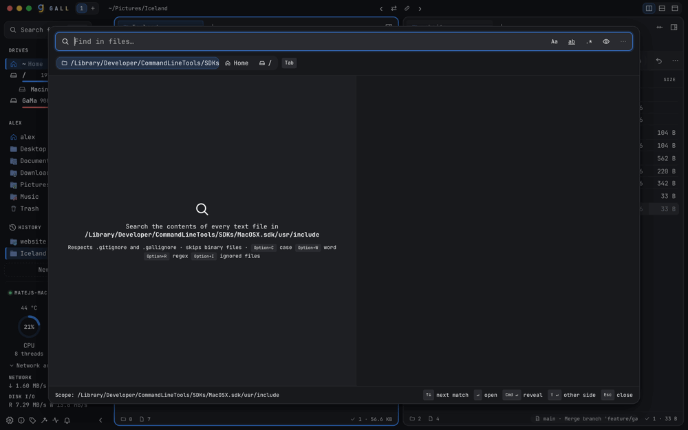
  <br><sub><b>Find in Files (<code>Ctrl+F</code> / <code>Ctrl+Shift+F</code>)</b> — ripgrep streaming matches with context preview</sub>
</div>

---

### Compare anything without leaving the file manager

Select two files and press <kbd>Ctrl+Shift+D</kbd> (Vim: <kbd>=</kbd> <kbd>=</kbd>), drop one file onto another, or compare against the clipboard or any Git commit (<kbd>=</kbd> <kbd>g</kbd>).

- **Text &amp; code** — side-by-side or unified, syntax-coloured, structural token diff (reformatting stays dimmed; <kbd>t</kbd> switches to plain line diff), moved-block detection, inline editing, hunk copy (<kbd>Alt+→</kbd> / <kbd>Alt+←</kbd>), and save (<kbd>Ctrl+S</kbd>).
- **Excel, ODS &amp; CSV** — cell-by-cell comparison with automatic key-column row matching and added/removed rows and columns.
- **Images** — side-by-side, draggable swipe divider, onion skin, or pixel-difference percentage (`1`–`4`).
- **Folders, documents &amp; binaries** — directory sync with preview/undo, multi-file similarity matrix, positioned `.pdf`/`.docx` comparison, and chunked hex diff.

<table>
  <tr>
    <td width="50%">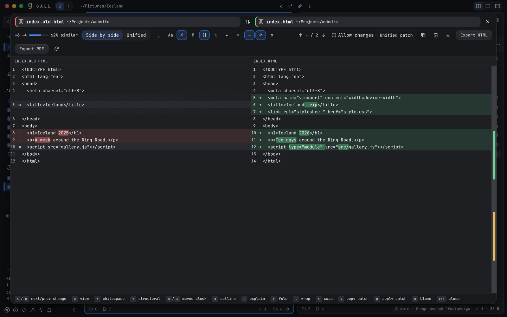</td>
    <td width="50%">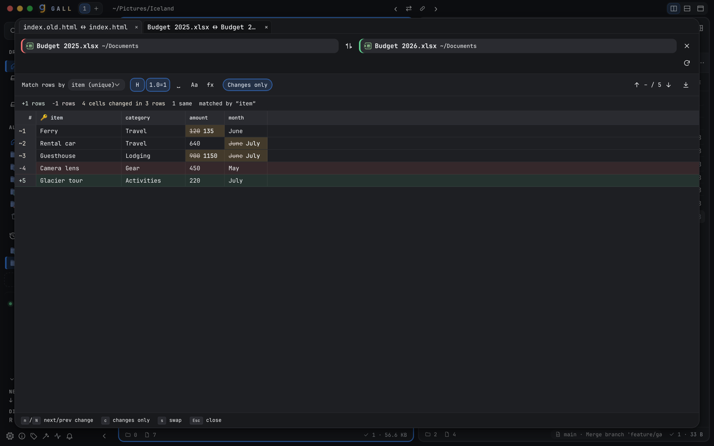</td>
  </tr>
  <tr>
    <td align="center"><sub><b>Code &amp; text</b> — structural token diff with inline merge</sub></td>
    <td align="center"><sub><b>Excel / ODS / CSV</b> — cell-by-cell with key-column matching</sub></td>
  </tr>
  <tr>
    <td colspan="2" align="center">
      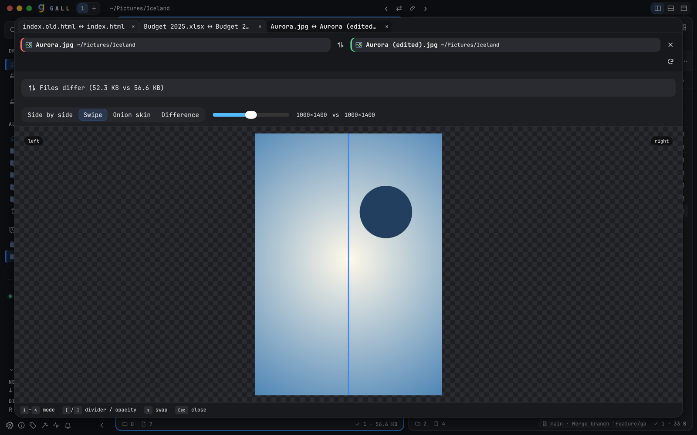
      <br><sub><b>Images</b> — side-by-side, swipe divider, onion skin, and pixel difference</sub>
    </td>
  </tr>
</table>

<details>
<summary><b>Compare shortcuts, Git revision compare &amp; structural diff notes</b></summary>

- **Universal compare keys:** `n`/`N` (or `]`/`[`, `F8`) jump between changes; `Esc` or `q` closes; `?` lists all shortcuts for the active mode. In text diff: `u` toggles split/unified, `s` swaps sides, `Alt+→`/`Alt+←` copies a change across, `Ctrl+S` saves. In folder diff: `>`/`<` copies selection, `c` compares contents, `f` filters.
- **Git revision comparisons:** Select a file and choose **Compare with › Git commit** (Vim: `= g`), or `= r` to start with **Only this file** (rename-following) checked. `= h` compares the working file against `HEAD`; `= l` compares the last commit against its first parent. Comparison never switches branches or modifies disk files unless you edit and save the working side. Type `+ +` in Vim mode to focus the other browser (`=` and `+` show their next keys).
- **Structural diff conservatism:** Whitespace stays literal in prose, YAML, markup, JSX/TSX, shell files with heredocs or backslash escapes, C preprocessor directives, JavaScript lines after an ambiguous `/`, C-family raw strings/text blocks/continued directives, Lua long bracket strings, and INI/properties files. Comparison uses a lexer rather than full language parsers; Git hunks lack preceding comment/string context so token marks can be approximate while lines remain accurate. Line-ending-only changes are still flagged even when ignoring line endings.

</details>

---

### Keyboard profiles, Vim motions &amp; which-key

Choose **Windows Explorer**, **Total Commander**, or **Vim** in welcome setup or **Settings › Keyboard**. Every profile keeps Gall's search, compare, archives, tabs, and commands; <kbd>?</kbd> opens a searchable, profile-aware shortcut reference, and chord shortcuts are rebindable.

With Vim enabled, navigate with `j`/`k`/`h`/`l`, jump with `gg`/`G`, yank/cut/paste with `yy`/`dd`/`p`, filter with `/`, bookmark folders with persistent marks (`m a`, `' a`, `` ` a ``, `''`, `d m a`), and press <kbd>Space</kbd> for a LazyVim-style which-key menu (in Explorer/Commander, tap <kbd>Ctrl</kbd> twice).

<table>
  <tr>
    <td width="50%">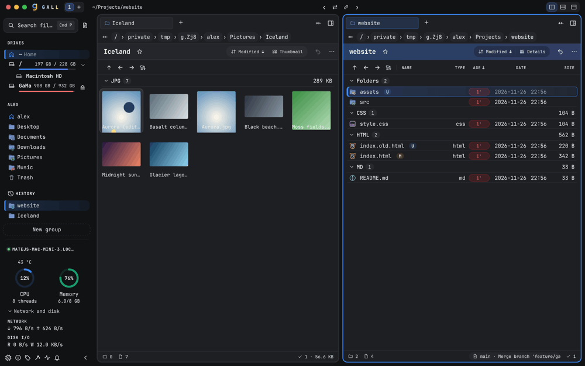</td>
    <td width="50%">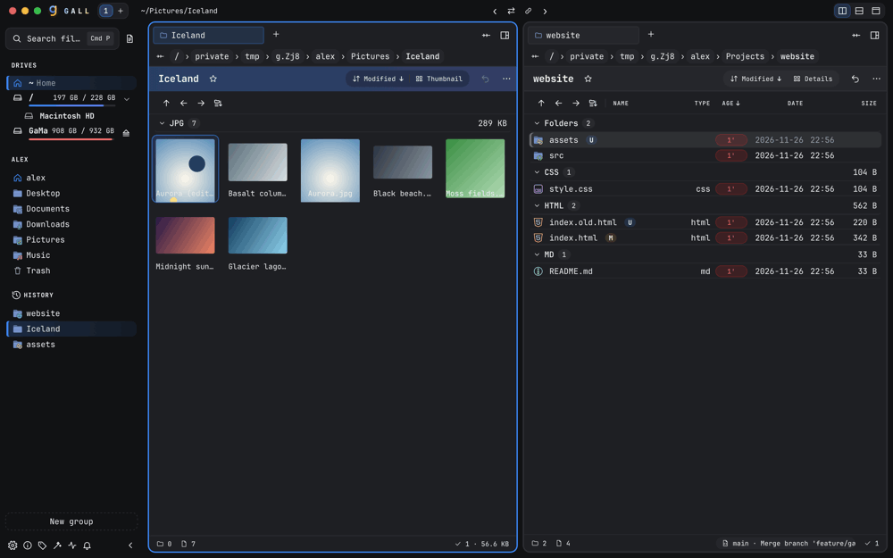</td>
  </tr>
  <tr>
    <td align="center"><sub><code>j</code> <code>k</code> <code>l</code> <code>h</code> through folders</sub></td>
    <td align="center"><sub><code>Space</code> opens grouped which-key commands</sub></td>
  </tr>
  <tr>
    <td colspan="2" align="center">
      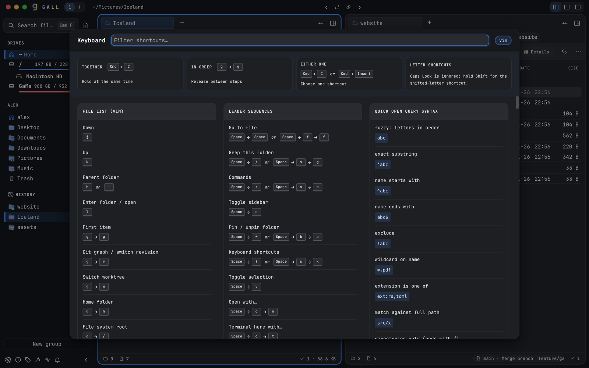
      <br><sub><code>?</code> opens a live-searchable sheet of every active shortcut</sub>
    </td>
  </tr>
</table>

---

### Layouts, themes, honest drag &amp; drop, and sidebar monitor

Dark and light themes are built in alongside **Gruvbox**, **Night Owl**, custom CSS themes (`Ctrl+Shift+F5` live reload), Nerd Font + Catppuccin icons (with automatic SVG fallback), colour-coded file age, and an optional sidebar machine monitor (CPU, GPU/VRAM, memory rings, temperatures, disk/network throughput, and drive usage bars).

<table>
  <tr>
    <td width="50%">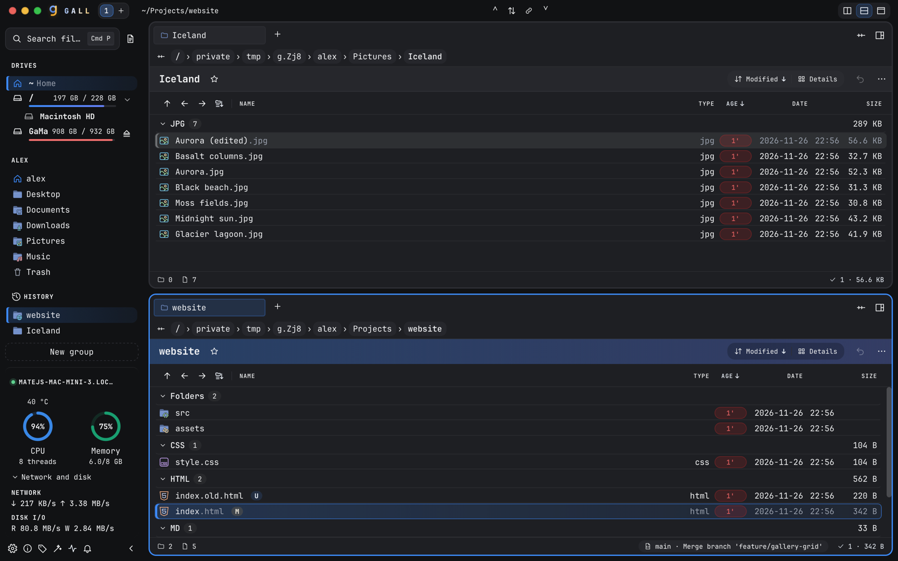</td>
    <td width="50%">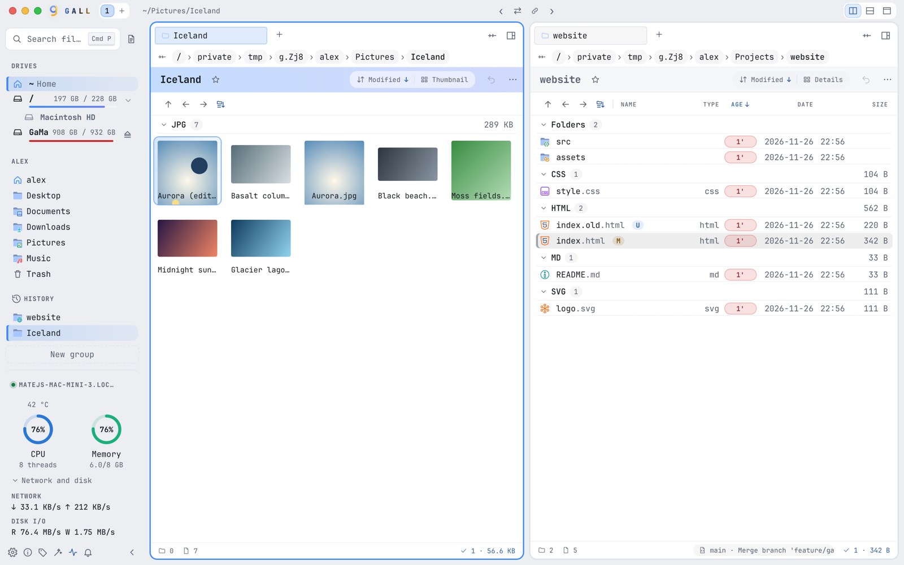</td>
  </tr>
  <tr>
    <td align="center"><sub><b>Stacked dual pane</b> — full-width breadcrumbs and wide details</sub></td>
    <td align="center"><sub><b>Light theme</b> — thumbnail grid &amp; grouped details side by side</sub></td>
  </tr>
  <tr>
    <td width="64%">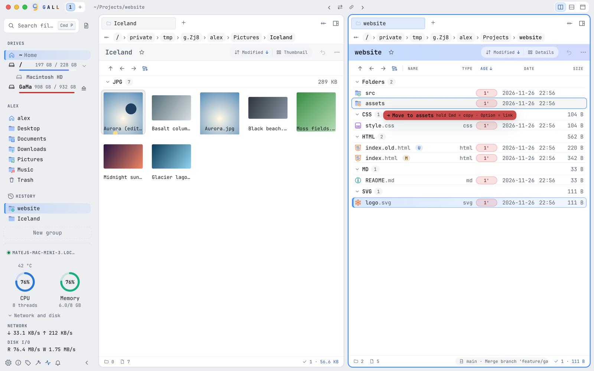</td>
    <td width="36%" align="center">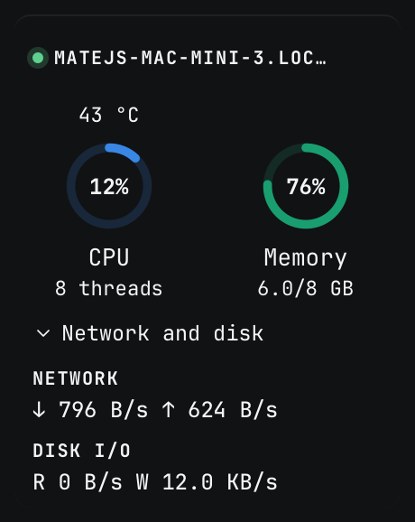</td>
  </tr>
  <tr>
    <td align="center"><sub><b>Honest drag &amp; drop</b> — always labels Move, Copy, or Symlink before release</sub></td>
    <td align="center"><sub><b>Sidebar monitor</b> — collapses cleanly when space is tight</sub></td>
  </tr>
</table>

### Everything else at a glance

| Area | Capabilities |
| --- | --- |
| **Layouts &amp; tabs** | Side-by-side, Stacked, and Single layouts (`Ctrl+Shift+L`); clickable breadcrumb bars (jump, middle-click tab, drop targets, `Ctrl+L` inline edit); per-pane tabs with clone, reopen (`Ctrl+Shift+T`), clipboard-path tab (`Ctrl+Shift+Alt+T`), drag-reorder, numbered Workspaces (`Alt+1..9`) with Drop Portals, and linked/tandem/flow Tab Pairs. |
| **File list &amp; previews** | Natural sort per folder, collapsible groups (`Ctrl+F7` / `,g`), accent-insensitive type-to-filter, per-pane hidden toggle (`.` / `Ctrl+H`), 5 views (`Ctrl+wheel` thumbnail sizing). Previews (`Alt+P` pane, `Space`/`i` modal): syntax-highlighted code, Markdown, PDF, zoomable images, video/audio with frame-step, 3D STL models, archives, and `.2do` notes. |
| **Archives &amp; folder sizes** | Open `zip`, `7z`, and `tar` (`gz`, `xz`, `bz2`, `zst`) read-only like folders (including encrypted zip/7z); extract/compress from the context menu. Calculate folder totals on demand (`Ctrl+Alt+S`) or automatically in the background (deduplicating hard links, skipping `/proc`/`/sys`). |
| **Rename &amp; undo** | Smart `F2` rename (cycles name / extension / full) and batch rename with templates (`Trip {n:2}`, `{date}`, `{folder}`), regex find/replace, case transforms, or multi-line text editing. `Ctrl+Z` undoes copy, move, rename, batch rename, merge, extract, and trash. |
| **Tags, sidebar &amp; updates** | Colour tags (`Ctrl+Alt+T` / `c`), folder colours, file templates (`Ctrl+N`), drives with mount/eject/encrypted unlock, cloud folders, favourites groups, Trash window, honest drag-and-drop modifiers (`Ctrl` copy, `Shift` move, `Alt` link), and signed background updates. |
| **Git &amp; open-with** | Inline Git status (`M`/`S`/`U`/`!`) and branch ahead/behind in the status bar without running repository hooks; full [Git workspace](#git-workspace) (`g r`); native `Ctrl+Enter` Open-with rules per file/folder/project, `F10` terminal here, and `Ctrl+Alt+E` / `F4` editor. |

Full platform coverage: [docs/04-compatibility-matrix.md](docs/04-compatibility-matrix.md).

---

## Install

Download packages for Linux, Windows, and macOS from **[GitHub Releases](https://github.com/GaMa87/gall/releases/latest)**.

| System | Package | Install |
| --- | --- | --- |
| **Fedora (with updates)** | [COPR](https://copr.fedorainfracloud.org/coprs/gama87/gall/) | `sudo dnf copr enable gama87/gall && sudo dnf install gall` |
| **Any Linux** | `Gall_<version>_amd64.AppImage` | `chmod +x Gall_*.AppImage && ./Gall_*.AppImage` |
| **Debian, Ubuntu, Mint** | `Gall_<version>_amd64.deb` | `sudo apt install ./Gall_*.deb` |
| **Fedora, openSUSE** | `Gall-<version>-1.x86_64.rpm` | `sudo dnf install ./Gall-*.rpm` |
| **Windows 10/11** | `Gall_<version>_x64-setup.exe` / `.msi` | Run the installer |
| **Windows (portable)** | `Gall-<version>-windows-x64-portable.zip` | Unzip anywhere and run `gall.exe` |
| **macOS (Apple silicon / Intel)** | `Gall_<version>_aarch64.dmg` / `_x64.dmg` | Open and drag to Applications |

> [!TIP]
> **macOS:** Builds are not notarised yet — if macOS blocks first launch, allow it in *System Settings › Privacy & Security › Open Anyway*.
> Flathub, AUR, Scoop, winget, and Homebrew packages are in preparation ([packaging/README.md](packaging/README.md)).

<details>
<summary><b>Windows portable USB mode, Linux default file manager &amp; video codecs</b></summary>

- **Portable (Windows):** Unzip `Gall-<version>-windows-x64-portable.zip` anywhere and run `gall.exe`; settings stay in `%APPDATA%\gall` and signed updates replace the binary in place inside writable folders. For a USB stick, create an empty file named `portable` next to `gall.exe` to store everything in `./UserData` beside it. Build it yourself with `./scripts/portable.ps1` (Windows) or `./scripts/portable.sh` (Linux with [cargo-xwin](https://github.com/rust-cross/cargo-xwin)).
- **Default file manager (Linux):** `.deb` and `.rpm` packages register Gall as a file manager (and Gall's Welcome wizard / *Settings › Open with* can set it as default on Linux, Windows, and macOS). On KDE Plasma, choosing Gall in *Default Applications › File manager* also binds `Meta+E`.
- **Video preview (Linux):** Uses the webview's system GStreamer codecs (Fedora: `gstreamer1-plugins-good`, `gstreamer1-libav`; Debian/Ubuntu: `gstreamer1.0-plugins-good`, `gstreamer1.0-libav`).

</details>

---

## Build from source

Requirements: **Rust ≥ 1.95**, **Node ≥ 20**, and [Tauri v2 prerequisites](https://v2.tauri.app/start/prerequisites/) (Fedora: `webkit2gtk4.1-devel libsoup3-devel gtk3-devel openssl-devel librsvg2-devel`; Debian/Ubuntu: `libwebkit2gtk-4.1-dev libsoup-3.0-dev libgtk-3-dev librsvg2-dev`).

```sh
git clone https://github.com/GaMa87/gall.git && cd gall
npm install && npm install --prefix ui
npm run dev          # run with hot reload
npm run build        # release build + installers in target/release/bundle/
npm test             # Rust + UI unit tests
npm run lint         # fmt, clippy, typecheck
./scripts/selftest.sh   # end-to-end UI test of a debug build
```

---

## Usage

```sh
# Desktop commands (single-instance: sends paths to the open window)
gall [PATH]                 # open PATH in the left pane
gall -p2 PATH               # open PATH in the right pane
gall PATH --newtab          # open PATH in a new tab
gall --new-window [PATH]    # open another window (same process)
gall select ITEM...         # open the folder with ITEM selected (also --select)
gall diff A B [--wait]      # compare two files or folders (also --compare)
gall merge BASE LOCAL REMOTE OUT  # open three-way merge editor
gall git [REPO]             # open the Git workspace (also --git)

# Headless CLI for scripts and AI agents (no window, exit 1 on stderr error, supports --json)
gall search QUERY [--dir FOLDER] [--limit N] [--json]
gall grep PATTERN [--dir FOLDER] [--regex] [--word] [--case|--ignore-case] [--glob G] [--limit N] [--json]
gall selection [--json]
gall skill install          # install the Gall agent skill (~/.claude/skills and ~/.agents/skills)
```

`gall search` and `gall grep` default to the current folder. Prefix `./diff` for a folder named like a subcommand.

Key everyday shortcuts: `Ctrl+P` quick open · `Ctrl+F` / `Ctrl+Shift+F` find text · `Ctrl+Shift+D` compare · `?` all shortcuts · `F2` / `Shift+F6` rename · `Alt+C` / `Alt+M` copy/move to other pane · `Ctrl+Shift+N` new folder · `Alt+F7` name search · `F10` terminal here · `Alt+P` preview pane · `Alt+S` sidebar · `Ctrl+,` settings.

### Keyboard profiles

Select a profile in **Settings › Keyboard** or during welcome setup:

| Key | Windows Explorer | Total Commander | Vim |
| --- | --- | --- | --- |
| `F1` | Keyboard help | Keyboard help | Command palette |
| `F2` | Rename | Refresh | Rename |
| `F3` | Name search | Preview | Name search |
| `F4` | Edit address | Edit file | Edit file |
| `F5` | Refresh | Copy to other pane | Refresh |
| `F6` | Other pane | Move to other pane | Move to other pane |
| `F7` | Show long names | New folder | Show long names |
| `F8` | Move to trash | Move to trash | Move to trash |

<details>
<summary><b>Profile rules, chord overrides &amp; shortcut notation</b></summary>

- Every profile keeps Gall's core shortcuts: `Ctrl+R` refresh, `Ctrl+Alt+E` edit file, `Ctrl+Alt+L` long names, `Shift+F4` choose editor, `F10` terminal, `Ctrl+B` pin (Vim: `b` or `Space b p`), `Ctrl+Shift+P` command palette, `Ctrl+Insert`/`Shift+Insert` copy/paste, and `Ctrl+F3`–`F6` sort by name/type/date/size.
- Explorer and Commander support type-to-filter, `Tab` pane switch, `Space` preview, `Insert` mark-and-advance, and double-tap `Ctrl` for the grouped command menu. Vim keeps motions, `yy`/`dd`/`p`, `/` filter, `Space` leader, `Space v` toggle selection, `Space o m` context menu, `v` visual mode, and `c` colour tag.
- `?`, `Shift+F1`, and `Ctrl+/` open profile-aware help in all three profiles (`?` stays ordinary typing inside inputs).
- Custom chord overrides in *Settings › Shortcuts* apply across all profiles and override profile defaults; clearing a field restores the profile default.
- Keycap legend: `+` means hold together (`Ctrl + C`), `→` means sequential presses (`g → g`, `Ctrl → Ctrl`), and `or` lists alternatives. Uppercase Vim keys are explicit (`Shift + g`).
- Middle-click a tab to close it (`Ctrl+Shift+T` reopens); `Alt+Middle-click` moves a tab to the other pane.

</details>

### Search scope and exclusions

Quick Open (<kbd>Ctrl+P</kbd>) searches the **open folder and its subfolders** first; press <kbd>Tab</kbd> to switch to **everywhere** (the system index) and again to return. Right-click any noisy file or folder and choose **Hide from search** to write a `.gallignore` rule (gitignore syntax, undoable, works outside Git too). Press <kbd>Alt+I</kbd> in Quick Open, Find in Files, or `F3` to include ignored/excluded matches on demand.

<details>
<summary><b><code>.gallignore</code> example &amp; indexing details</b></summary>

```gitignore
# Skip generated output and logs
/generated/
*.log
# Keep this log searchable
!important.log
```

- Quick Open reads unindexed folders (WSL, network shares, outside configured roots) on demand while you type; configure permanent roots in *Settings › Search › Indexed folders* and global exclusions in *Settings › Search › Never index or search*.
- Folders containing a valid `CACHEDIR.TAG` are skipped automatically. Inside archives, Quick Open searches the system index (`Alt+I` and folder scope are unavailable).
- Hidden matches are counted cleanly in the empty state or footer; `Alt+I` reveals them dimmed with a `hidden` badge. `Ctrl+H` / `.` only toggles hidden files in the file list and does not override search exclusions.

</details>

### Windows: browse WSL distributions

Installed WSL distributions appear under **Drives** in the sidebar (stopped distributions live under **Not mounted** and start on click). You can also enter `\\wsl.localhost\Ubuntu\home\yourname`, `\\wsl$\Ubuntu\…`, or `/etc` directly in the path bar, open a WSL shell with <kbd>F10</kbd>, and copy Linux paths via **Copy path › Linux path (WSL)**.

<details>
<summary><b>WSL trash, naming rules &amp; stopping distributions</b></summary>

- Docker Desktop's internal distributions are intentionally hidden.
- Copy, move, rename, and preview work seamlessly between Windows and WSL or across distributions. In Find in Files, **Home** resolves to the Linux home when opened from WSL.
- Deleting inside WSL uses the distribution's Linux trash (`Ctrl+Z` restores it); Gall's Trash window lists the Windows Recycle Bin only. If trash is unavailable, Gall confirms before permanent deletion.
- Copying names Windows cannot store onto a Windows drive is refused with an explanation (rename trailing dots/spaces inside WSL first).
- **Stop … (WSL)** terminates the entire distribution — save work in other WSL programs first. Press `Ctrl+R` to refresh external changes.
- Verification checklist: [docs/wsl-manual-test.md](docs/wsl-manual-test.md) · [0.1.3 changelog](CHANGELOG.md#013--2026-11-05).

</details>

### Gall as the open / save dialog (Linux)

`xdg-desktop-portal-gall` provides a Freedesktop FileChooser backend so browsers and desktop apps can use Gall for Open, Select folder, and Save As dialogs (`Enter` chooses a file, `Ctrl+Enter` chooses selection/folder, `Escape` cancels). Enable with `org.freedesktop.impl.portal.FileChooser=gall;gtk` in `portals.conf` (`packaging/omarchy/hyprland-portals.conf.example`, installed by `packaging/arch/gall`; verify via `./scripts/portal-smoke.sh`).

### Settings, data and themes

- **Paths:** On Linux, settings live in `~/.config/gall/` and data in `~/.local/share/gall/`; **Settings › About** shows exact paths on every OS. Place an empty `portable` file beside the binary to redirect all storage to `./UserData`.
- **Themes:** Pick **Gruvbox** or **Night Owl** in *Settings › Appearance › Custom theme*, or place your own `.css` file in `~/.config/gall/themes/` and live-reload with <kbd>Ctrl+Shift+F5</kbd> ([theme guide &amp; Dracula example](docs/themes/README.md)).
- **Languages:** Automatic OS detection (live on Omarchy), with complete, test-enforced translations in **English**, **Slovenian**, **German**, and **Spanish**.

---

## Git workspace

Click the Git status in the bottom bar, press <kbd>g</kbd> <kbd>r</kbd> (Vim), or run **Open Git graph** from the command palette to open the current repository in a full-window workspace: commit graph with Working Changes at the top, sidebar for branches/tags/stashes/remotes/conflicts, and commit details with patches, file history, and blame.

<div align="center">
  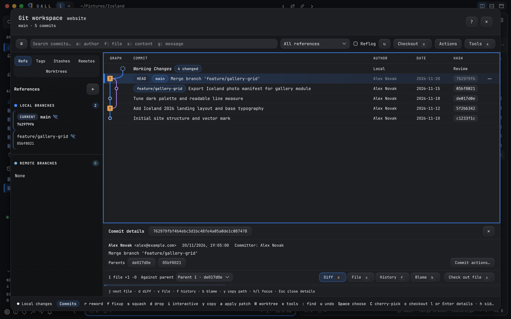
</div>

<br>

Everything works via buttons and context menus; with Vim keys enabled, contextual lazygit-style shortcuts and a live footer guide drive every panel. Press <kbd>?</kbd> for the focused panel's keys or <kbd>:</kbd> / <kbd>Ctrl+Shift+P</kbd> for any Git command by name. All Git commands can be rebound in **Settings › Shortcuts**.

| Focus | Key Vim shortcuts |
| --- | --- |
| **History** | `r` reword · `i` interactive rebase · `f` fixup · `s` squash · `d` drop · `Space` choose · `v` range · `c` checkout · `n` branch · `T` tag · `C`/`V` cherry-pick · `y` copy · `Y` save patch · `t` revert · `g` reset · `W`/`N` worktree · `Ctrl+E` compare base · `/` search |
| **Working Changes** | `Space` stage/unstage · `a` stage/unstage all · `c` commit message · `A` amend · `d` discard · `i` ignore/exclude · `s` stash · `l` diff · `h` files |
| **Diff selection** | `x` choose changed line · `v` range · `]`/`[` hunks · `Space`/`Enter` apply · `d` discard · `u` unstage selected |
| **Interactive rebase** | `p` pick · `r` reword · `s` squash · `f` fixup · `d` drop · `e` edit stop · `J`/`K` move · `m` message · `Ctrl+Enter` start |
| **Commit details** | `d` diff · `v` file · `f` history · `b` blame · `y` copy path · `e` edit working file · `h`/`l` focus files/preview |
| **References** | `Space` checkout · `n` branch · `R` rename · `d` delete merged · `M` merge · `r` rebase · `u` upstream · `W`/`N` worktree |
| **Stashes &amp; Remotes** | Stashes: `Space` apply · `g` pop · `d` drop · `s` save &nbsp;·&nbsp; Remotes: `n` add · `e` edit URL · `r` rename · `d` remove |

<details>
<summary><b>Git graph, revision switching &amp; explicit checkout</b></summary>

- Loads 200 commits initially (**Load 200 more** up to 20,000); filter by branch/tag or include unreachable commits with **Reflog** (off by default). Orange `T` markers indicate tags with background origin status checks.
- Selecting commits, searching, filtering, and opening diffs never alter `HEAD` or disk files. Shift-click two commits (or press `W` twice / `Ctrl+E`) to compare revisions; merge commits let you pick which parent to diff against.
- Move between panels with `h`/`l` (or `Tab`/`Shift+Tab` without Vim), switch sidebar tabs with `[`/`]`, copy commit metadata/diffs/URLs with `y`, and open Tools tabs directly (`b` bisect, `w` worktrees, `x` default).
- **Checkout…** is always explicit. With local edits, choose **Stash** (includes untracked), **Commit**, or **Discard** (double confirmation; saves a recovery copy under `refs/gall/recovery/`). Detached HEAD states are also preserved under `refs/gall/recovery/`.

</details>

<details>
<summary><b>Staging lines/hunks, committing &amp; amending</b></summary>

- Open the **Working Changes** row above `HEAD` to manage staged and unstaged files separately (**Stage/Unstage file**, **Stage/Unstage all**). Partially staged files appear in both sections.
- For tracked text files, check individual changed lines or click a hunk's `±` button to **Stage selection** / **Unstage selection** (binary, mode, rename, massive patches, or files without a final newline stage whole-file). Stale `HEAD`/index snapshots cancel safely and prompt a refresh.
- **Amend latest commit** pre-fills an empty message with the previous commit message. **File actions…** offers confirmed unstaged discard (with recovery stash) and ignore rules in `.gitignore` or `.git/info/exclude`.

</details>

<details>
<summary><b>Branches, stashes, remotes, conflicts &amp; conflict forecast</b></summary>

- Create/rename/delete merged branches, set upstreams, create lightweight or annotated tags, and run merge, rebase, cherry-pick, revert, or soft/mixed/hard reset. History rewrites retain the prior `HEAD` under `refs/gall/recovery/` until completion; hard reset refuses untracked/ignored files.
- **Conflicts:** In-progress operations show **Continue**, **Skip** (unavailable for merge), and **Abort**. Pick Ours, Theirs, or Both with a live Result preview, or **Edit** manually before marking resolved.
- **Conflict forecast:** The branch list flags branches that would conflict if merged into the current branch without merging anything (requires Git 2.38+, configurable branch cap default 50).
- **Remotes &amp; stashes:** Add/rename/edit/remove remotes; **Pull** fast-forwards only; **Push** sets upstream; **Force push with explicit lease…** requires reviewing the remote commit lease. Stash stack (`z`) supports search (`/`), diff preview, partial stash (`S`), branch creation (`n`), apply (`Space`), pop (`g`), and drop (`d`, with recovery ref).

</details>

<details>
<summary><b>Rewriting history (reword, squash, fixup, drop &amp; interactive rebase)</b></summary>

- Press `r` (reword), `f` (fixup), `s` (squash), `d` (drop), or `Ctrl+j`/`Ctrl+k` (`Alt+Down`/`Alt+Up`) to reorder linear commits.
- Press `i` to open **Edit commits through HEAD** (up to 1,000 linear commits; non-root, non-merge topology). Pick, reword, squash, fixup, drop, or pause on `edit`, reorder by drag/buttons/`J`/`K`, and resume conflicts or edit stops even after restarting Gall.
- Submodule-aware: interactive and ordinary rebase rewrite parent commits (including submodule pointers) without modifying submodule checkouts, then list mismatched submodules for explicit update in **Tools → Submodules**. Embedded repos like `.worktrees` are identified cleanly if staged and can be unstaged + excluded locally.

</details>

<details>
<summary><b>Worktrees, line history, blame, reflog, image diff, search, multi-commit &amp; undo</b></summary>

- **Worktrees:** `Ctrl+Alt+W` (Vim: `gw`) jumps across repository worktrees (MRU first, with dirty count and ahead/behind). Press `W` on any branch/tag/commit (or `N` for a new branch) to create a worktree in one keystroke; `X` opens a temporary detached worktree that auto-cleans when closed unmodified. Supports custom location templates (`../{repo}-{branch}`), local `.git/info/exclude`, and `.worktreeinclude` for copying ignored files like `.env`.
- **Line history &amp; Blame:** Select lines and press `L` for commit history; scrub revisions with `[`/`]`. Click a line or press `B` for full-file blame (`Enter` opens commit, `P` blames parent, `Backspace` goes back; honours `.git-blame-ignore-revs`, up to 1 MiB / 10,000 lines).
- **Reflog &amp; Undo:** `H` searches reflog + Gall operations (`R` creates branch or resets). `u` undoes the last Gall Git operation (`Ctrl+R` redoes; `U` opens the 100-operation / 4-week timeline with preview). Undo never overwrites dirty local files.
- **Searching commits &amp; multi-commit selection:** `/` filters loaded commits and searches full history with prefixes (`a:` author, `g:` message, `f:` path, `s:` added/removed text — combinable like `a:ana f:src/login`). Select multiple commits with `Space`/`v` (or Ctrl/Shift-click) to cherry-pick (`C`/`V`), copy (`y`), or save a patch (`Y`).
- **Image diffs &amp; Tools:** Changed images in commits or Working Changes open in the four-mode image diff (`1`–`4`; SVG starts in text diff). **Tools** provides Repository init/clone, Worktrees, Submodules, manual Bisect, Patch apply/export, and Commit notes.
- **Safety &amp; limits:** Gall creates unsigned commits and disables repository hooks. Content-filter/LFS repos and submodule worktrees restrict mutating index/history operations while keeping inspection tools available. Full matrix: [docs/git-workspace-roadmap.md](docs/git-workspace-roadmap.md).

</details>

---

## Architecture

```text
React + TypeScript UI  ── typed IPC ──▶  Tauri v2 shell  ──▶  gall-core (pure Rust)
                                                              fs · nav · view · preview · storage
```

`gall-core` has zero UI dependency and is unit-tested on Linux, Windows, and macOS in CI. Full breakdown: [docs/03-architecture.md](docs/03-architecture.md).

## Roadmap

- Image conversion
- Multiple and named windows
- Thumbnail cache in Rust
- Drag files *out* to other applications
- Distribution packages for Flathub, AUR, Scoop, winget, and Homebrew ([packaging plan](packaging/README.md) — help welcome)

## Contributing

Contributions are welcome — please read [CONTRIBUTING.md](CONTRIBUTING.md) and the [clean-room policy](docs/00-clean-room-policy.md). Report security issues via [SECURITY.md](SECURITY.md).

### Report a problem

Open **Report a bug** from **About**, **Settings › About**, or any unexpected error notification. Gall prepares a compact, local-first report (environment + latest recorded error only — nothing uploads automatically), lets you capture annotated/redacted screenshots or short silent clips of Gall, and pre-fills the GitHub issue form or exports a single ZIP.

<details>
<summary><b>Capture, redaction, diagnostics &amp; export details</b></summary>

- **Capture Gall:** 3-second countdown capturing only Gall's webview. **Annotate** supports arrows, boxes, and opaque redactions (`Add mark`, arrows or `h/j/k/l` to position, `Shift` to resize); **Apply changes** permanently flattens redactions so originals are never exported.
- **Record a clip:** Up to 20 seconds, silent (no mic/camera/system audio), lightweight (≤4 fps, 1280×800, MP4 or WebM). Stop anywhere with `Ctrl+Shift+Enter` or cancel with `Ctrl+Shift+Backspace` (`Cmd` on macOS). Redactions do not apply to video clips.
- **Add a file:** Up to 3 attachments (PNG, JPEG, WebP, MP4, WebM; 8 MiB each). Built-in capture works on Windows (WebView2), Linux (WebKitGTK), and native macOS (`WKWebView` snapshot for screenshots; import system recordings for clips).
- **Save report… vs. Copy &amp; open GitHub:** **Save report…** writes a timestamped ZIP (`report.md` + finalized attachments) and optionally includes sanitized extra diagnostics (recent actions, UI context, log excerpts — saved-only, never copied into the GitHub URL). **Review report → Copy &amp; open GitHub** monitors encoded URL length and recommends ZIP export if too long. Neither action overwrites existing files or uploads automatically.
- Drafts stay in memory while Gall runs (`Esc` closes/cancels); after an irregular exit, Gall can offer previous-session diagnostics.

</details>

## Support

Gall is free and built in spare time. If it saves you time, you can buy me a coffee via **[revolut.me/gama87](https://revolut.me/gama87)** (Revolut `@gama87`) or scan below. Stars, bug reports, and pull requests help just as much!

<a href="https://revolut.me/gama87"></a>

## License

[MIT](LICENSE) © 2026 Gall contributors. Third-party components and licences are listed in [THIRD-PARTY-NOTICES.md](THIRD-PARTY-NOTICES.md) (permissive or unmodified MPL-2.0, enforced in CI with [`cargo-deny`](deny.toml)).

<sub>Keywords: file manager, file explorer, breadcrumbs, dual pane, orthodox file manager, workspaces, fuzzy file search, find in files, ripgrep, diff, file compare, Excel compare, image diff, Git client, vim, which-key, Nerd Font, Tauri, Rust, Linux, Windows, macOS, KDE, GNOME, Wayland.</sub>
